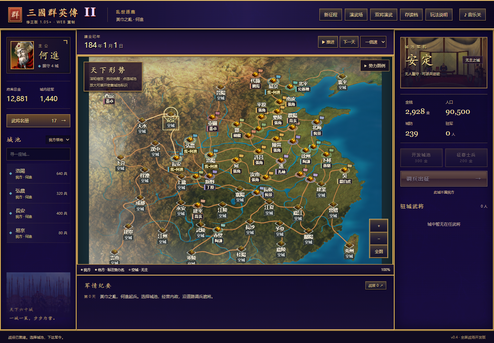
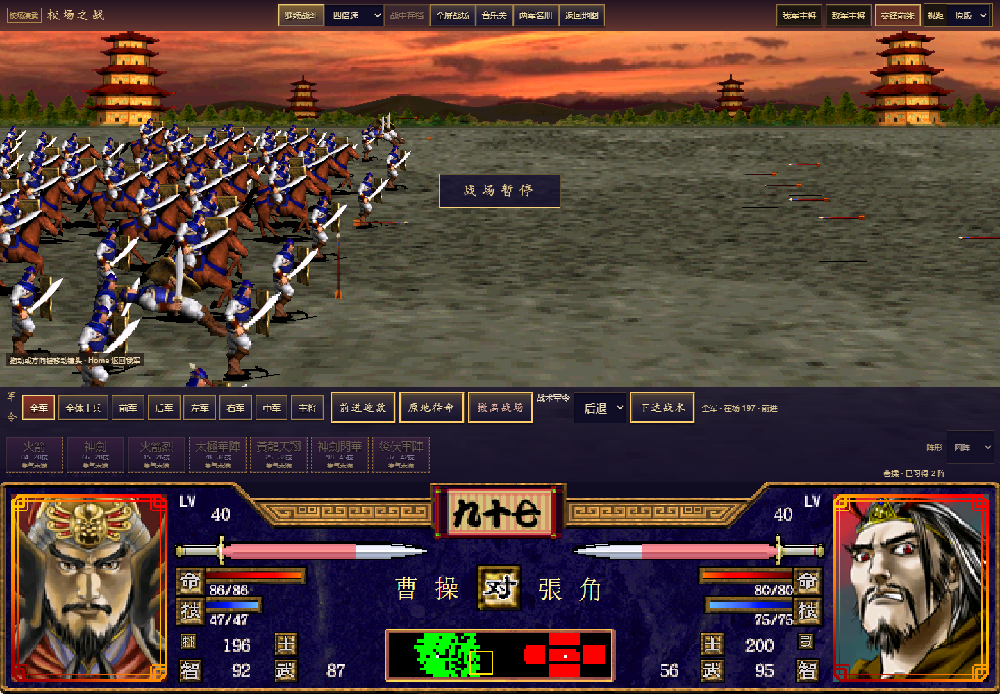
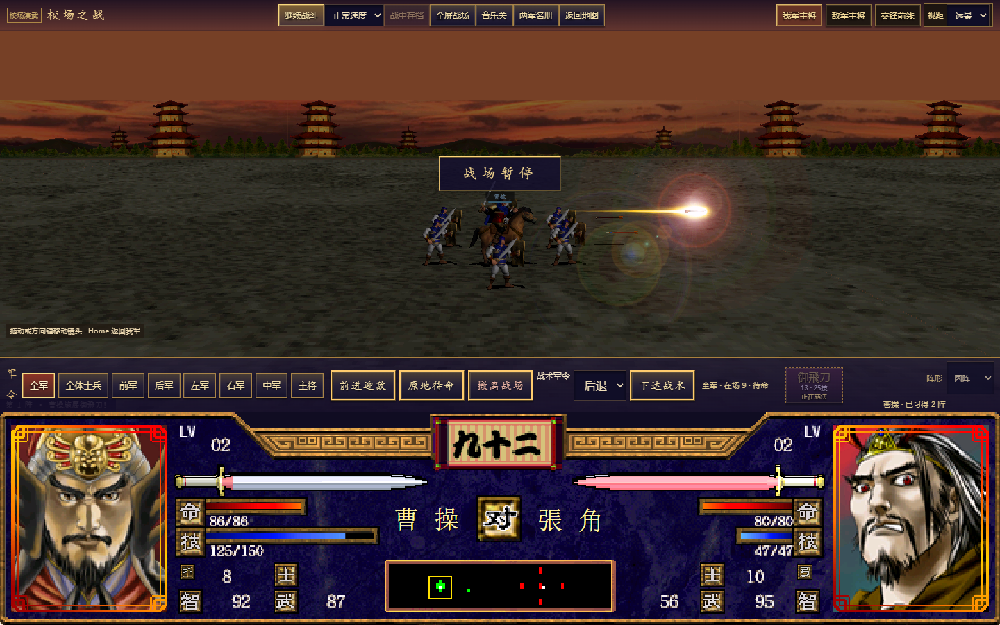
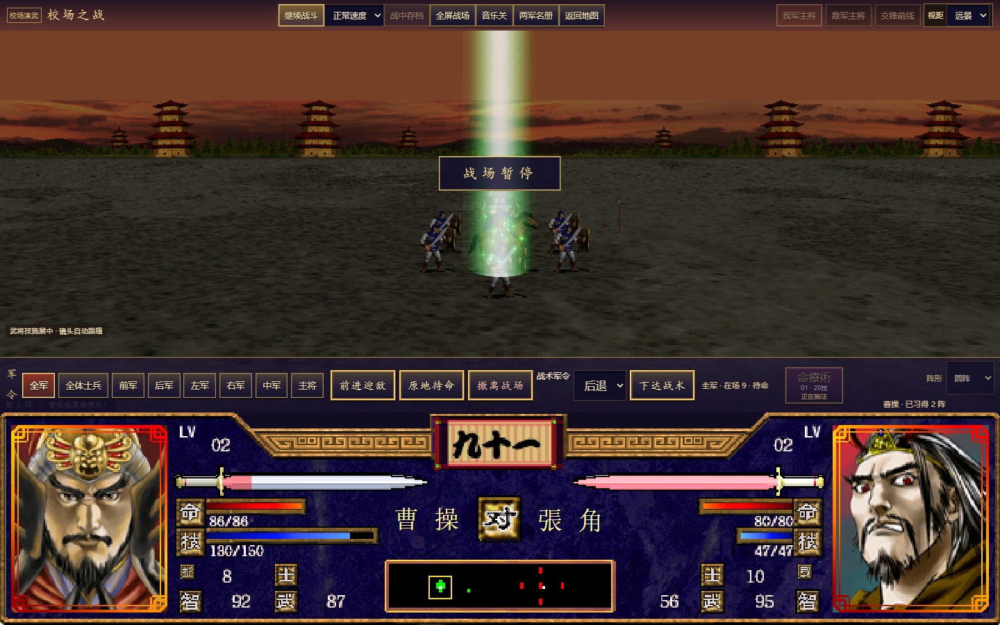
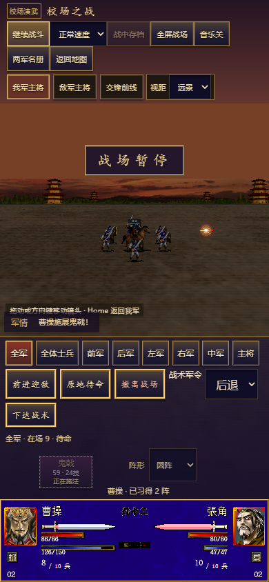
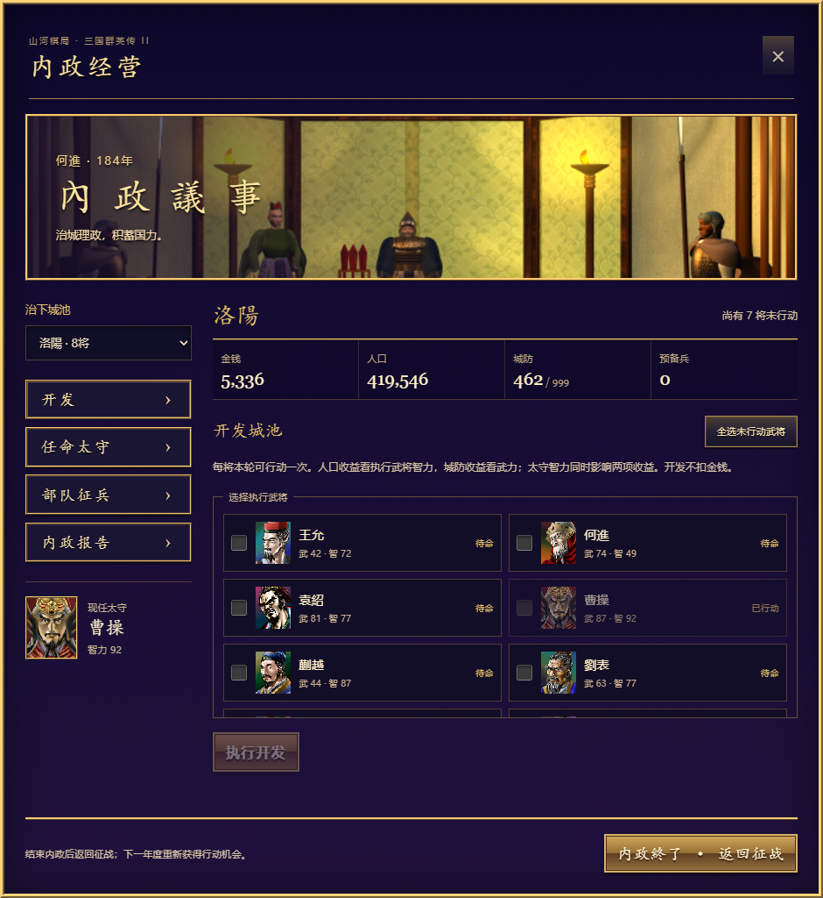
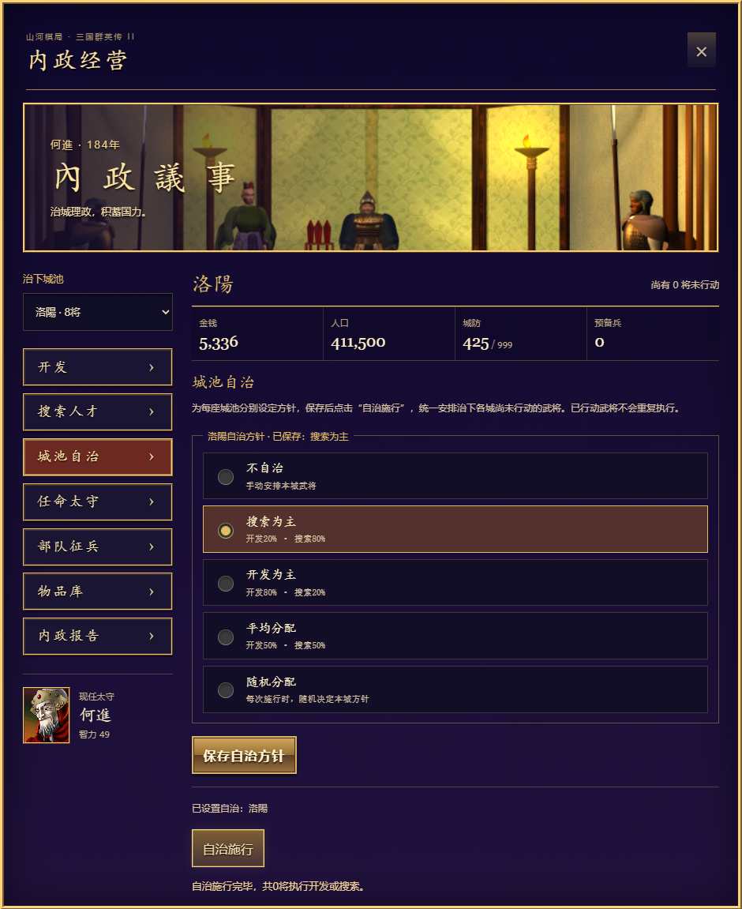
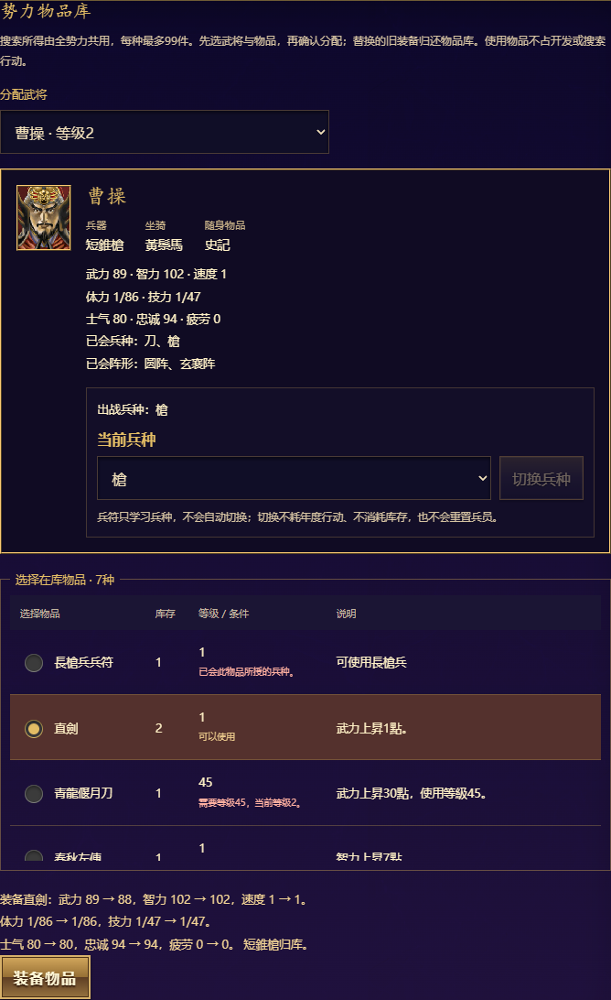
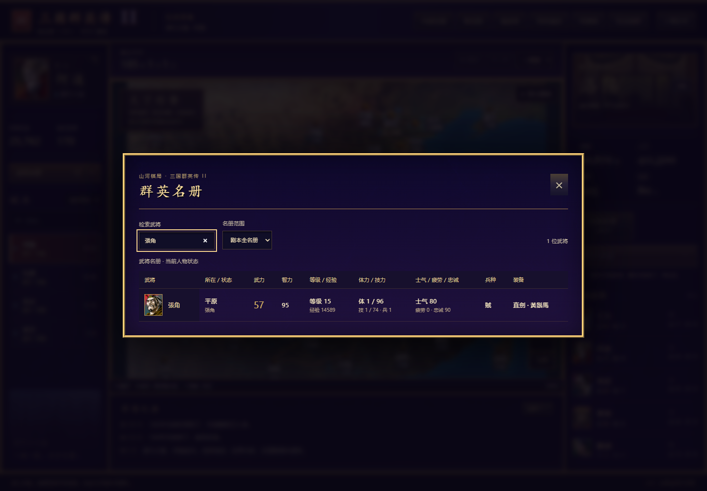

<div align="center">

<sub>HEROES OF THE THREE KINGDOMS II · WEB REMAKE</sub>

# 三國群英傳 II

**山河棋局 · 重返群雄逐鹿的年代**

原始像素素材 · 天下战略 · 实时交锋 · 原程序规则对照


[开始体验](#开始体验) · [实机画面](#实机画面) · [复刻进度](#复刻进度) · [开发与验证](#开发与验证)

</div>



<p align="center"><sub>五个历史剧本，六十座城池。从经营一城，到调兵出征。</sub></p>

这是基于《三国群英传2 修正版 1.05+》制作的浏览器重制项目。地图、人物、兵种、战场与音乐从本地游戏包转换；战役与战斗由独立的 TypeScript 模拟内核运行，无需启动旧客户端。

**当前为可游玩的开发版，尚未达到原版一比一验收标准。** 部分规则已有原机器码、原脚本与差分测试支撑；全局调度、完整技能、连续战役和部分 UI 仍在补齐。完整漏项、优先级与验收条件见[一比一复刻总账](sango2-web/docs/FULL-PARITY-BACKLOG.md)，原物品/军师技逐条范围见[内容核对表](sango2-web/docs/PARITY-CONTENT-INVENTORY.md)。

## 实机画面

<table>
  <tr>
    <td width="50%"></td>
    <td width="50%"></td>
  </tr>
  <tr>
    <td align="center"><b>列阵交锋</b><br><sub>五分队军令 · 九种阵形 · 原始战场面板</sub></td>
    <td align="center"><b>武将技出手</b><br><sub>原脚本时序 · 固定点飞行 · 实际占格碰撞</sub></td>
  </tr>
</table>

<details>
<summary><b>查看命疗术原圣光效果</b></summary>
<br>


治疗等待、子脚本与随机调用已对照原解释器；完整画面仍待原客户端逐像素验收。

</details>

截图来自本项目实际运行画面。战场图包含演武与测试配置，技能画面暂停于飞行途中，便于核查素材和位置。

<details>
<summary><b>查看手机竖屏画面</b></summary>
<br>
<p align="center"></p>

手机支持触摸拖动、战场视距和紧凑面板；横屏更接近原游戏的宽幅交战视野。

</details>

<details>
<summary><b>查看年度内政经营</b></summary>
<br>


新局先议政，再返回征战。现可开发、搜索人才与宝物、设置城池自治、任命太守和从预备池配兵；归附武将的经验成长进入实战，库存与搜索报告随存档保留。电脑现会跨年搜索、开发、追赶经验和换装；普通升级保留伤势与剩余兵力。物品库现可选择武将、预览属性、使用道具、替换归库、卸下随身物品，并从已学兵种中选择当前出战兵种；现役/预备兵的原对象与攻击动作随之更新。历史事件、特殊坐骑及战后经验来源仍待补，原兵种切换事件与兵员转换规则仍需核对。[年度规则与实际边界](sango2-web/docs/NATIVE-POLICY-ANNUAL-PARITY-2026-11-19.md)。

<table>
  <tr>
    <td width="50%"></td>
    <td width="50%"></td>
  </tr>
  <tr>
    <td align="center"><b>治城用人</b><br><sub>四种自治方针 · 每将每年一次行动</sub></td>
    <td align="center"><b>授兵赐宝</b><br><sub>逐将分配 · 属性预览与替换归库</sub></td>
  </tr>
</table>

物品分配画面使用指定库存与伤势的测试存档；正常游戏按全部77条原物品资料搜索。玩家入口新增384组原x86对照，并验证全部77件物品的提交和读档。[物品使用、卸装与实际边界](sango2-web/docs/NATIVE-PLAYER-ITEMS-PARITY-2026-11-19.md)。[搜索与自治的原码证据及剩余差距](sango2-web/docs/NATIVE-POLICY-SEARCH-PARITY-2026-11-19.md)。



<p align="center"><sub>年度成长验证局 · 升级保留伤势与兵力 · 运行属性与装备随存档恢复</sub></p>

上图使用设定伤势与累计经验的测试存档，便于核查升级行为；不是普通开局数值。[年度AI与装备证据](sango2-web/docs/NATIVE-POLICY-ANNUAL-PARITY-2026-11-19.md)。

</details>

## 开始体验

准备 **Node.js ≥ 22.22、pnpm 11.13.0、Python ≥ 3.12**，以及本地的《三国群英传2 修正版 1.05+》游戏目录。仓库提供源码、对照样本和截图，游戏包及生成的完整素材不随仓库分发。

以下为 Windows PowerShell 命令：

```powershell
git clone https://github.com/chency9/sanguo2.git
cd sanguo2/sango2-web

corepack enable
corepack prepare pnpm@11.13.0 --activate
pnpm install --frozen-lockfile

python -m venv .venv
.\.venv\Scripts\python.exe -m pip install -r tools/requirements.txt
.\.venv\Scripts\python.exe tools/convert_assets.py --game 'D:\Games\三国群英传2 修正版 1.05+'

pnpm dev
```

将 `--game` 替换为实际游戏目录，指向解压后包含 `Sango2.PAK` 和原包 MP3 的文件夹。转换器只读取资源，不运行 EXE；输出位于 `sango2-web/apps/game/public/assets/`。

打开 **[http://127.0.0.1:25369/](http://127.0.0.1:25369/)**。开发和生产预览均固定使用 `25369`；端口占用时直接报错，不自动换端口。游戏运行不需要后端服务或 API Key。

<details>
<summary>资源版本与常见启动问题</summary>

- **PAK 指纹不匹配**：当前转换器仅支持已分析的 1.05+ 资源，SHA-256 为 `4db9aa8d7ecaedc61b2826c63e4e130bffaae0f3c36c0c34b20bc76bb7bc47e6`。其他版本需要先核查数据差异。
- **素材缺失**：先完成转换，再启动开发服务或生产构建。仅克隆源码不能直接运行游戏。
- **找不到 pnpm / Corepack**：确认已安装所需 Node.js；若发行版未附带 Corepack，可先运行 `npm install --global corepack`。
- **音乐没有播放**：音乐默认关闭，点击界面的音乐按钮后启用；播放遵循浏览器的用户交互要求。
- **部署到子目录**：当前支持站点根路径；子目录部署尚未完成适配。

</details>

## 如何游玩

1. **开一局天下**：选择剧本与势力。地图滚轮缩放、拖动平移；城池用旗帜、文字和形状区分我方、他方与空城。
2. **年度经营与出征**：新局先在内政经营中安排开发/搜索、设置自治、任命太守或配兵，再点「内政終了」返回地图出征。每将每轮一次行动；下一年度恢复。预备池配兵与物品分配可在征战期间继续操作。物品库先选武将和物品，查看限制与属性预览后再确认；使用物品不占年度行动。使用兵符只学习兵种，随后在「当前兵种」选择并点击「切换兵种」，才改变出战部队；目前切换保留兵员，原切换事件的完整规则仍待核查。敌军抵达我方城池后进入守城战。
3. **体验演武**：顶部「演武场」与「双将演武」可直接试战，不改变战役。布阵时可选择已学阵形、地形、景色和军师计策，再点击「擂鼓开战」。
4. **指挥交锋**：选择全军、全体士兵、前后左右中军或主将，下达军令；使用已学且已实现的武将技。可暂停、倍速、切换视距，并在多将轮战中选择下一位出战武将。
5. **保存进度**：三个存档槽，支持 JSON 导入导出和战中保存。读回战中存档后先暂停，便于继续指挥。**目前没有自动保存**，演武不支持战役存档。

| 操作 | 效果 |
| --- | --- |
| 地图滚轮 / 拖动 | 以指针为中心缩放 / 移动地图；`Ctrl + 滚轮`保留浏览器缩放 |
| 战场拖动 / 方向键 | 移动镜头；方向键需先聚焦战场 |
| `Shift + 方向键` / `Home` | 加快镜头移动 / 返回我军主将并恢复原版视距 |
| 我军主将 / 敌军主将 / 交锋前线 | 切换镜头跟随目标 |
| 战场小地图 / 全屏战场 | 点击定位镜头 / 进入浏览器全屏 |

## 复刻进度

本项目采用 **资源解析 → 原码取证 → 规则移植 → 差分核验 → 浏览器验证** 的开发方式。局部函数输入输出一致，还不足以证明整局的状态、随机数和画面一致。

| 模块 | 当前已接入 | 仍需补齐 |
| --- | --- | --- |
| 天下与内容 | 五剧本；每剧本 60 城、401 人物记录、116 道路；城池归属、出征与战报 | 完整对象初始化、装备、事件、统一结局及特殊道路 |
| 年度内政 | 独立议政、开发/搜索、归附成长、四种自治、物品库、太守、预备池配兵、报告、年度税收与存档；电脑年度经营/经验处理/换装；玩家道具、换装、卸随身物品、兵阵学习和主动兵种选择 | 战后累计经验输入、原切换事件及兵员转换、特殊坐骑、原物品窗口/开放时机、历史事件、原系统对白与菜单逐像素对照 |
| 战略与战术 AI | 原版候选、权重、性格、双字 RNG、冷却、出阵、阵形、战术与选技函数 | 完整状态与调用顺序、连续战役回放；电脑双方交战仍有暂定自动结算 |
| 实时战斗 | 13 兵种、九阵、五分队军令、移动占格、普攻伤害、攻击命中帧、普通远程弹道、死亡与轮战；逐源集气/恢复、撤退扣气与坐骑速度 | 原混合对象链的完整调度、部分主将状态及非攻击动作；完整装备与成长 |
| 武将技与军师技 | 学习表、集气、部分军师效果；4 个飞射技能接原主流程及镜头；命疗术、回天术接 Heal 全部子协程、等待、回血和脚本 RNG | 104 个技能仍走暂定执行器；已接原脚本的 6 个仍有全局对象顺序、视觉或音效缺口 |
| 画面与操作 | 原素材面板、人物与坐骑；12 地形、24 组景色；原透视表、全屏、镜头与移动端适配 | DirectDraw 调色板逐像素对照、全部菜单与布局、战役地形自动匹配 |
| 存档 | 三槽位、JSON、战中状态、旧 Web 存档迁移与规则版本兼容 | 原版 SAV、自动保存、云存档与离线安装 |

最新贯通[兵符学习后的主动兵种选择与实战](sango2-web/docs/TROOP-SELECTION-2026-11-19.md)；前序补入[电脑年度内政、普通升级与装备属性](sango2-web/docs/NATIVE-POLICY-ANNUAL-PARITY-2026-11-19.md)，前序恢复[搜索、登用成长、库存与四种自治](sango2-web/docs/NATIVE-POLICY-SEARCH-PARITY-2026-11-19.md)，前序恢复[年度内政基础流程](sango2-web/docs/NATIVE-POLICY-PARITY-2026-11-19.md)，并建立[全系统漏项总账](sango2-web/docs/FULL-PARITY-BACKLOG.md)及[原内容逐项清单](sango2-web/docs/PARITY-CONTENT-INVENTORY.md)。前序补齐命疗术、回天术的原 Heal 与全部后代协程：30 个环绕光球、80 个随机光球、追踪光柱、逐点回血、施法等待和镜头。详见 [治疗规则与证据](sango2-web/docs/NATIVE-HEAL-PARITY-2026-11-19.md)。前序还原包括 [主将源更新、装备速度与飞行技能镜头](sango2-web/docs/NATIVE-GENERAL-CAMERA-PARITY-2026-11-19.md)；[当前完整差距表](sango2-web/docs/PARITY-STATUS-2026-11-19.md) 和 [110 技能逐项清单](sango2-web/docs/MAGIC-COVERAGE-2026-11-19.md) 按实际执行路径记录进度。

## 技术实现

| 层次 | 选型与职责 |
| --- | --- |
| 界面 | React 19 + TypeScript 7；战略操作、军令、名册与存档 |
| 图形 | PixiJS 8 绘制地图；Canvas 2D 绘制战场、原始精灵和透视地面 |
| 模拟 | 独立 TypeScript 内核；固定步长、16.16 坐标、可保存的随机状态 |
| 数据 | Python + Pillow 转换 PAK / SHP / TGA / TEX；IndexedDB 本地存档 |
| 工程 | pnpm workspace + Vite 8；Vitest + Playwright |
| 原码对照 | Unicorn + Capstone + pefile；执行指定原函数和脚本，导出差分样本 |

模拟与显示分离。渲染、镜头、缩放和暂停操作不消耗战斗随机数；旧存档按自身规则版本继续执行，不强行套用新规则。

```text
sanguo2/
├─ docs/images/                 README 实机截图
├─ sango2-web/
│  ├─ apps/game/                React 界面、地图、战场与素材输出
│  ├─ packages/core/            战役、AI、战斗内核与原码对照样本
│  ├─ packages/content/         内容类型与资源加载
│  ├─ tests/                    浏览器场景
│  ├─ tools/                    资源转换与人物/动画解析
│  └─ docs/                     规则证据、审查记录与截图
└─ web-port-research/
   ├─ docs/                     游戏解析、技术方案与验收计划
   └─ tools/                    原机器码 / SO 脚本对照工具
```

## 开发与验证

在 `sango2-web/` 内执行；全量测试和构建前需要先转换本地游戏资源：

```powershell
pnpm test
pnpm exec playwright install chromium
pnpm test:e2e
.\.venv\Scripts\python.exe -m unittest discover -s tools -p 'test_*.py'
pnpm build
pnpm preview
```

2026-11-19 本地验证结果：**44 个核心测试文件、14,718 项测试通过；54 个 Chromium 场景通过；6 项 Python 测试通过；类型检查与生产构建通过。** 本次新增17项主动兵种选择集成检查，覆盖13种兵的真实出征、现役/预备原对象与攻击动作及读档；前序有384组玩家物品入口原x86样本，并验证全部77件物品提交与读档、开发收益和真实出征；前序有840组电脑年度/普通升级/装备属性原x86样本；前序有780组搜索/登用/成长/自治及240组开发/税收机器码样本；前序有72组完整 Heal 脚本树样本，共28,224次源更新；前序有主将源更新 640 组、镜头轨迹 142 组原码差分，以及 698 组原装备速度样本。数字为本次本地运行记录，不表示全局复刻验收或在线 CI 状态。

[查看命令日志](sango2-web/docs/evidence/commands/) · [开发操作说明](sango2-web/README.md) · [历次开发记录](sango2-web/DEVELOPMENT-HISTORY.md)

## 继续深入

| 主题 | 文档 |
| --- | --- |
| 游戏内容与整体路线 | [总体方案](web-port-research/docs/00-Web重制总体方案.md) · [资源解析](web-port-research/docs/01-资源与数据全量解析.md) · [实施与验收](web-port-research/docs/05-实施里程碑与验收.md) |
| 完整漏项与内容 | [一比一复刻总账](sango2-web/docs/FULL-PARITY-BACKLOG.md) · [内容逐项核对](sango2-web/docs/PARITY-CONTENT-INVENTORY.md) · [年度内政](sango2-web/docs/NATIVE-POLICY-PARITY-2026-11-19.md) · [搜索与自治](sango2-web/docs/NATIVE-POLICY-SEARCH-PARITY-2026-11-19.md) · [电脑年度与装备](sango2-web/docs/NATIVE-POLICY-ANNUAL-PARITY-2026-11-19.md) |
| 核心 AI | [原版 AI 决策与验收边界](sango2-web/docs/NATIVE-AI-PARITY-2026-11-17.md) · [军师决策](sango2-web/docs/NATIVE-STRATEGIST-PARITY-2026-11-17.md) |
| 战斗规则 | [普攻与强化](sango2-web/docs/NATIVE-COMBAT-PARITY-2026-11-17.md) · [单位时钟](sango2-web/docs/NATIVE-UNIT-CLOCK-PARITY-2026-11-17.md) · [分队与军令](sango2-web/docs/NATIVE-COMMAND-PARITY-2026-11-18.md) |
| 战场呈现 | [原透视与镜头](sango2-web/docs/NATIVE-PROJECTION-CAMERA-PARITY-2026-11-18.md) · [渲染审查](sango2-web/docs/BATTLE-RENDER-AUDIT-2026-11-19.md) |
| 最新源更新与镜头 | [主将、装备速度与技能镜头](sango2-web/docs/NATIVE-GENERAL-CAMERA-PARITY-2026-11-19.md) · [飞行技能主脚本与碰撞](sango2-web/docs/NATIVE-MAGIC-SHOOT-PARITY-2026-11-19.md) |
| 完整差距核查 | [全范围当前状态](sango2-web/docs/PARITY-STATUS-2026-11-19.md) · [110 个技能逐项覆盖](sango2-web/docs/MAGIC-COVERAGE-2026-11-19.md) |

研究文档中指向 `data/`、`previews/`、原始二进制证据的路径属于本地分析产物，不在公开仓库中；Web 内核的差分样本和测试源码随仓库提供。

---

<p align="center"><b>以原版为尺，逐条还原这片山河。</b></p>

游戏图像、音乐及原作内容归各自权利人所有。截图用于展示复刻开发进度；运行所需的游戏资源请在本地提供。PAK / SHP 解析参考 Sango2 English patch 工具，其 MIT 许可与说明保留在 [NOTICE](sango2-web/tools/NOTICE.md) 和 [许可副本](sango2-web/tools/LICENSE-sango2-english-patch.txt) 中；该许可不覆盖原游戏素材。
