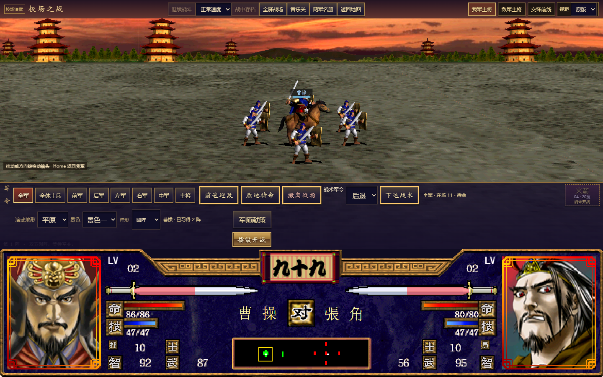
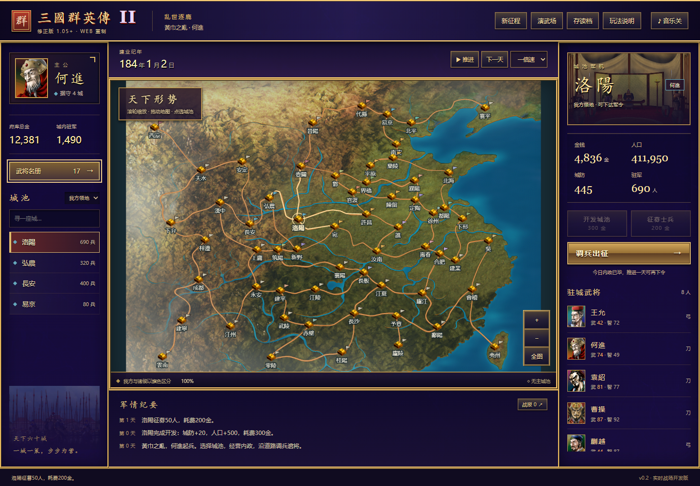

# 三国群英传 II · 历次开发记录

> 本文保留 2026-11-19 四种飞行武将技接入之前的历史说明，其中的“最新”、测试数量和待办反映当时状态。当前启动方法、截图与进度见[仓库首页](../README.md)，本轮规则见 [ShootObject 原码对照](docs/NATIVE-MAGIC-SHOOT-PARITY-2026-11-19.md)。

基于用户提供的《三国群英传2 修正版 1.05+》。目标是按原版内容和行为复刻；**目前仍未达到一比一验收标准**。已接入战略层和实时战场，不将真实素材或暂定规则标为完整还原。

最新（2026-11-19）：修复技能命中高度丢失、补兵闪光漂移、特效引用的尸体过早清理，以及远近视距下人物与地形缩放不一致。地面连续采样、素材外全景延展和天空补色一并核查；旧存档保留回退路径。核心 11,211 项、浏览器 40 场景、类型检查及构建通过，详见[战场渲染与存档边界核查](docs/BATTLE-RENDER-AUDIT-2026-11-19.md)。原始全局调度及完整技能脚本仍有差距。

2026-11-18：接入五分队独立军令、十种士兵命令分支、四种主将命令，以及 AI 按阵形分批推进。修正冲锋误带主将、共享目标尸体提前删除等问题，战中存档保留分队命令。1,080 组原机器码样本通过，详见[五分队与军令对照](docs/NATIVE-COMMAND-PARITY-2026-11-18.md)。

本轮（2026-11-18）：战场显示接入原版 4096 项透视表、640×344 镜头语义、扫描线地面、71×14 小地图、对象缩放/朝向和镜头定位；单位、投射物、尸体共用逻辑固定点，修复逻辑相邻但画面隔开的现象。镜头支持主将/前线定位、拖动、方向键和小地图点击，详见[原版透视与镜头对照](docs/NATIVE-PROJECTION-CAMERA-PARITY-2026-11-18.md)。完整地面纹理状态、全局对象链和全部技能投影仍未完成，不能宣称整局一比一。

此前九种普通阵形已接入原版逻辑坐标表、双方镜像和占格冲突搜索，选阵限制为当前武将已学内容，切换武将同步更新。234 组原程序部署样本通过，详见[九阵形部署对照](docs/NATIVE-FORMATION-PARITY-2026-11-18.md)。

此前补齐普通/特殊攻击的原动作链和命中帧，并接入弓箭、飞刀、链锤、弩箭的独立投射物、沿途碰撞、偏转和飞行中存档恢复。266 个攻击动作流与 240 组投射物轨迹由原程序对照，详见[攻击动作与命中帧对照](docs/NATIVE-ATTACK-ANIMATION-PARITY-2026-11-18.md)和[远程弹道对照](docs/NATIVE-PROJECTILE-PARITY-2026-11-18.md)。

此前普攻命中/伤害已改为原机器码核实规则，接入兵种及地形克制、城防加成和 12 个强化类军师技执行项，并统一战斗与 AI 随机流。证据、保存兼容及剩余差距见[普攻与强化对照](docs/NATIVE-COMBAT-PARITY-2026-11-17.md)。

后续已接入士气、疲劳、忠诚及 15 个相关军师技执行项：临时士气在本阵结束恢复，疲劳和离间造成的忠诚损失写回战役，驻城按原计时恢复。武将名册可查看状态。初始化、机器码对照和旧存档边界见[人物状态对照](docs/NATIVE-CONDITION-PARITY-2026-11-17.md)。

本轮继续：现役兵/预备兵按原级别容量同时部署，补齐预备兵动画与攻击事件，军师喝声分别扣除两类兵员。AI 不再把超编总数当作预备兵；分兵种伤亡随轮战、战役与存档延续。证据及兼容边界见[兵员部署对照](docs/NATIVE-TROOP-PARITY-2026-11-17.md)。

最新继续：补上兵员死亡击飞与脱离坐骑的随机调用、定点运动和延迟事件；AI查询改为原版71×14网格规则并计入主将，小地图共享坐标映射。旧战中存档保留旧规则，详见[死亡与网格对照](docs/NATIVE-CASUALTY-PARITY-2026-11-17.md)。

移动更新：新战斗接入原版候选格抽签、先占目标格后行走、16.16 定点速度和阻塞朝向，移动段可存读档；AI 与小地图读取同一占格。855 组机器码对照通过；递归友军让路、完整攻击/命令调度仍待接齐，详见[移动与占格对照](docs/NATIVE-MOVEMENT-PARITY-2026-11-17.md)。

后续让路更新：新战斗已接入友军提前更新与递归让路，防止同一单位重复更新，v1 战中存档继续旧顺序。新增 168 组原函数/真实单位回调链对照；完整逐源更新时钟和攻击调度仍未接齐。详见[友军让路对照](docs/NATIVE-YIELD-PARITY-2026-11-17.md)。

单位时钟更新：v3 新战斗已逐次源更新处理单位决策和索敌，普通/撤退时钟、独立搜索冷却、同排射程/友军阻挡、特殊攻击抽签、近战命中时重新查格以及普通远程投射物均已接入。主将速度字段、全局调度、武将技弹道仍有差距，见[单位时钟与攻击搜索对照](docs/NATIVE-UNIT-CLOCK-PARITY-2026-11-17.md)。

## 启动与体验

```powershell
cd E:\code\games\sanguo2\sango2-web
pnpm dev
```

打开 http://127.0.0.1:25369/。开发与预览均固定此端口；端口被占用时直接报错，不自动切换。

1. 选择剧本与势力。地图支持滚轮缩放（100%–400%，以鼠标位置为中心）、拖动和复位。Ctrl+滚轮保留浏览器页面缩放。
2. 点击顶部「演武场」按武将等级体验朴刀兵对阵弓兵（初期曹操为2级、10名现役兵）；「双将演武」可体验逐将轮番出阵。演武不改变战役。
3. 选择已学阵形，点「擂鼓开战」。可分别选择前、后、左、右、中军和主将，下达前进、待命等军令；选「全体士兵」可下达冲锋而保留主将待命。战术下拉框提供后退、分散、集中和护卫等命令。撤离战场作用于全军且不能取消；支持暂停与倍速。
4. 战役中，何進从洛陽向壺關出征，三天后进入战场。战斗结束点击「收兵 · 返回天下」，实际余兵、战报和城池归属才写回。
5. 「存读档」有三个槽位和 JSON 导入导出。战中也可保存；刷新后关闭新征程，从存读档恢复，会以暂停状态回到原战斗时刻。**没有自动保存。**
6. 推进日历可观察原版加权 AI 的补兵、调兵和出征；本轮不行动也有原始权重，不保证固定第五天出兵；敌军向我方城池行军时出现来袭预警，抵达后进入守城战斗，玩家仍控制左侧部队。具体目标由当前局势决定。

音乐默认关闭；主动开启后，地图与战斗切换使用原包 MP3。战斗自动铺满窗口，「全屏战场」可进一步隐藏浏览器边框。手机竖屏保留整支部队与人物比例，横屏更接近原游戏的宽幅交战视野。





## 本轮改变

- 已替换上一轮暂定 AI：按原 EXE 移植五套性格参数、战略候选及不行动权重、双字随机数、行动冷却、出阵选将、阵形决策、战术七类评分和八槽选技。新增隔离执行原机器码的对照工具，1128 项对照测试通过。**决策函数对齐不等于整局一比一**；完整状态、技能执行、行军与自动结算仍有差距，详见[原版 AI 移植与验收边界](docs/NATIVE-AI-PARITY-2026-11-17.md)。

- 前轮历史（其暂定 AI 已被上述原生内核替换）：定期内政、占空城、择弱进攻、留守和前线增援；电脑势力之间自动结算，玩家受攻时进入可指挥、可存读档的守城战斗。加入来袭预警和势力行军标识，修复攻守身份、超时胜负和失城退路；战场敌将可按条件使用已实现的命疗术及撤退。规则、原版证据边界和测试见[敌方 AI 记录](docs/ENEMY-AI-2026-11-17.md)。

- 固定端口 25369。地图补齐我方/他方/空城的文字、形状、势力色及图例；标签随缩放避让，攻占和读档实时更新。新战斗改为原版 99 计数、11880 次源更新时限，使用原始中文倒计时字图；旧战中存档保留原时限。详见[城池归属与计时证据](docs/MAP-OWNERSHIP-AND-CLOCK-2026-11-17.md)。

- 根据 IDA 证据修正重复 SKILL / WISESKILL 的“学习等级、技能编号”解析，并按原生经验阈值和属性公式初始化等级、体力、技力。曹操初期技能正确显示为火箭；已学但未实现的技能禁用，界面与核心共用施法条件。
- HUD 接入原版 5×7 / 6×9 数字字图、13 种兵种图标、肖像框与原始坐标；恢复兵力小地图区域，修正双向剑槽裁切。旧战中存档补齐学习表并保留当前战斗状态。证据、对照数值及限制见[原生学习与 HUD 对齐](docs/NATIVE-LEARNING-HUD-2026-11-17.md)。

- 接入原包 12 套战场地形、24 组景色与对应音乐，演武布阵时可选择；修复后排士兵站在天空、城墙被画到 HUD 后方的问题。场景随存档及轮战保留。战役自动地形映射仍待校准，详见[原版差距审查](docs/PARITY-AUDIT-2026-11-17.md)。
- 百人列阵采用更宽的行列间距和错列站位，步兵与主将分别等比缩放；行进及攻击期间增加友军避让，旧战中存档的增援入口拥堵时等待空位；新战斗已改为两类兵员同时上阵。详见[兵员间距修复记录](docs/BATTLE-SPACING.md)及[新列阵画面](docs/screenshots/spacing-deployment.png)。
- 下方 HUD 直接使用原包 WAR0D.SHP（640×136）和 WAR09/WAR0B 剑形集气条，体力/技力使用独立容量条；双侧肖像和属性按原生坐标定位。源素材保持比例；窄屏改为可读的紧凑排列。名册按需展开，选将使用原生对话框。
- 修复演武场显示弓兵却沿用刀兵外观的问题，兵种图集和攻击事件现在一并切换。

- 将战斗从单主将改为逐将轮战：出征武将分别携带兵力，主将败退后进入选将间歇，余将继续出阵；体力、技力、伤亡和撤退状态跨阵保留，整场战斗才写回城池。
- 真实外观映射：按原始 `TYPE`、武器 `WEAPONOBJECT`、坐骑对象和兵种对象生成每名武将的身体/武器/坐骑/士兵对象。动作事件 `@%OM_ATTACK` 同时驱动伤害和渲染；图集拆为 2048 分页并按本阵人物按需加载。
- 出征界面支持逐将配兵，校验每名武将兵力总和与军队总兵力一致；武将名册和驻城列表展示当前体力、技力、配兵。
- 战中存档升级保留旧战斗的时钟、单位、随机数和动作进度；旧战略存档增加个体状态并按已有军队重新分配。
- 战场进入独立全屏层：战略顶栏和状态栏不再占用战斗画面，原始战场帧铺满桌面或手机视口；HUD、军令、轮战选将和战报覆盖在场景上。支持浏览器原生「全屏战场」按钮，并使用 `dvh` 与安全区域适配刘海屏。

- 修复滚轮无响应：原先没有 wheel 监听。新增非被动监听、deltaMode 归一化、鼠标世界坐标锚定、缩放上下限与拖动边界。测试先复现旧版失败，再验证修复。
- 原版蓝紫石纹、金色边框、武将肖像框、列阵背景和宫殿城池面板。地图使用原素材城池与军团图标。
- 导出 231 个战场对象、5,789 张源帧：13 种兵种现役/预备各有蓝红两套普通和特殊攻击、4 类原版远程投射物、15 类主将身体、全部武器、主将坐骑及预备兵死亡脱离坐骑对象。攻击动作和投射物 WAIT/DEATH 帧已通过原解析器核对；其余动作保留原有转换方式与 SHP 锚点。
- 独立固定步长战斗模拟：新战斗每步 51/1024 秒，旧存档保留 20 Hz；逐兵索敌、近战、远程攻击、受击死亡、主将体力、分队命令、布阵、撤退与胜负。
- 敌城瞬时公式结算已被实时战场替换；冻结战略日历，完成后一次性回写。同日到达的军团排队处理。
- 战中保存包含单位位置、体力、动作、命令、预备兵和随机数。v0.1 Web 存档可迁移，保留资源与进度。

## 一比一复刻差距

| 部分 | 已接入 | 仍待校准或实现 |
|---|---|---|
| 内容 | 五剧本，每剧本60城/401人物记录/116道路，400头像、地图、音乐 | 特殊城池、SELECT、初始化语义 |
| 战场素材 | 12 套原地形、两组景色、配置音乐、兵种蓝红配色、TYPE/武器/坐骑对象映射，原始攻击事件 | TYPE、镜头与图层坐标仍需可执行原版逐帧校验；城池/道路自动地形匹配未完成 |
| 战斗 | 原版普攻命中/伤害、兵种与地形克制、城防、预约格移动和源决策时钟、普通/特殊攻击动作与事件、四类普通远程投射物、九阵逻辑格、五分队与十种士兵命令分支 | 主将速度、全局对象顺序、武将技投射物、非攻击动作、逐阵专用军令菜单和画面坐标仍有 Web 适配 |
| 兵力 | 原版级别容量、现役/预备同时部署、分队人数舍入；九阵按原表占格及独立分队指挥；分别保存伤亡到轮战和战役 | 初始/手动配兵仍是聚合数量适配，特殊部署、推断补兵的分队归属和显示布局尚未对齐 |
| 技能与AI | 原生学习表、集气、命疗术、部分军师效果；原版战略候选/权重/RNG/冷却、出阵/阵形/战术/选技评分；阵形学习限制与分批推进、冲锋目标游标 | 完整战略状态、全局随机调用顺序、菜单所有禁用条件、其余技能/军师效果、年度内政与人才决策 |
| 战役 | 内政、逐将配兵、占城、战斗回写，个体 HP/MP/兵力、士气/疲劳/忠诚延续及驻城恢复 | 成长、俘虏、搜索/装备、事件、统一结局；完整人物状态调用链待补 |
| 保存 | 三槽位、跨页冲突检测、战中保存、旧Web存档迁移 | 原SAV、云存档、自动保存、离线安装 |

敌方按原版冷却和权重决策，可主动出兵；电脑之间交战仍使用暂定自动结算公式。城内预备池按原式周期自动扣除100金补一兵，电脑在决策时分配预备兵。13 兵种相克表已接入普攻；普通阵形逻辑格、移动/射程和军令分支已有原函数对照，特殊部署、完整菜单和画面位置仍待校准。技能的原码核实与推断执行边界以各对照文档为准。

暂定战略规则：初始每名在任武将80兵（有主城至少80）；开发300金增加20城防/500人口；征兵200金把50人口转为50兵；每城每天一次内政；每30天收入为人口千分之一；一年360天；行军每天60道路单位，至少两天。特殊长道路未开放。城防已按原式参与守城方实时战斗战力。

新战斗按原生 11880 次更新倒计时，界面显示 99 计数（并非 99 秒）；旧战中存档保留原 180 秒时限。超时仍采用 Web 规则令进攻方撤军；主将败退或超时后余兵直接回城，不模拟战略撤退路线。新战斗的现役/预备容量和分队人数已按原函数对照；旧存档超编兵员保留在场外，不自动增援，这是兼容适配。旧版历史战报保留、不重算。

## 工程

TypeScript 7、React 19、PixiJS 8（地图）、Canvas 2D（战场图集）、Vite 8、pnpm 11、IndexedDB；Python/Pillow转换资源。

- `apps/game/src/WorldMap.tsx`：地图与输入。
- `apps/game/src/BattleView.tsx`：战场渲染、时钟与军令。
- `apps/game/src/classic.css`：原版材质主题和战斗布局。
- `packages/core/src/index.ts`：战役命令、战斗接入、迁移和校验。
- `packages/core/src/battle.ts`：无DOM的固定步长模拟。
- `packages/core/src/native-commands.ts`、`battle-commands.ts`：原版军令路由、AI 分队推进与战斗状态接入。
- `packages/core/src/native-strategic-ai.ts`、`native-tactical-ai.ts`：原版决策函数；`native-ai-campaign.ts`：战役状态适配。
- `tools/convert_assets.py`：PAK/SHP/TGA/TEX转换与动画图集。

`dispatch`不改变输入状态；`tickBattle`只修改调用者持有的快照。显示刷新率不进入伤害计算。现有实现仍需性能剖析后决定是否迁入Worker。

## 新环境构建

要求Node.js ≥22.22、pnpm 11、Python ≥3.12。资源由本地游戏包生成、不提交到Git。

```powershell
pnpm install --frozen-lockfile
python -m venv .venv
.\.venv\Scripts\python.exe -m pip install -r tools/requirements.txt
.\.venv\Scripts\python.exe tools/convert_assets.py --game 'E:\code\games\sanguo2\game-original-105plus\三国群英传2 修正版 1.05+'
pnpm build
pnpm preview
```

固定PAK指纹：`4db9aa8d7ecaedc61b2826c63e4e130bffaae0f3c36c0c34b20bc76bb7bc47e6`。不修改原游戏、不执行EXE。输出到`apps/game/public/assets`，构建为`apps/game/dist`，预览http://127.0.0.1:25369/。目前只支持站点根路径。

## 验证

最新（2026-11-19）：11,211 项核心测试、40 个 Chromium E2E 场景、类型检查与生产构建通过。新增技能命中高度、固定入口、纹理连续性、特效引用生命周期、视距变换和实际天空像素回归。证据见[战场渲染与存档边界核查](docs/BATTLE-RENDER-AUDIT-2026-11-19.md)。以下保留历史验证记录。

```powershell
pnpm test
pnpm exec playwright install chromium
pnpm test:e2e
pnpm build
```

2026-11-17：2149项核心与资源测试、27项Chromium E2E全量通过；前轮4项Python转换器测试通过，类型检查及生产构建通过。新增444组军师选择和500组运行时效果/恢复原机器码样本，接入“选将→军师→阵形→擂鼓”流程、体力技力上限、集气修正、恢复、封技及存档状态校验；修复入城与开战重分兵、守城太守首槽。通过三次独立客户端启动确认原版Rate值为4214897（配置Level不能代替），详见[军师决策证据与限制](docs/NATIVE-STRATEGIST-PARITY-2026-11-17.md)。既有AI状态与行军约束、五剧本各60日状态验证、来袭预警、玩家守城、战中读档、失城退路及战术治疗/撤退继续通过。60日测试快速结束玩家战斗，不代表全局一比一；原始链表顺序、全局连续回放、完整战场网格、未支持EXECUTE和电脑双方实战仍待完成。

后续差距见[全屏战场记录](docs/V04.md)、[逐将交锋记录](docs/V03.md)与相邻`web-port-research`。工具许可见[NOTICE](tools/NOTICE.md)；游戏图像、音乐不由工具MIT许可覆盖。本次仅本地开发，未发布站点。
