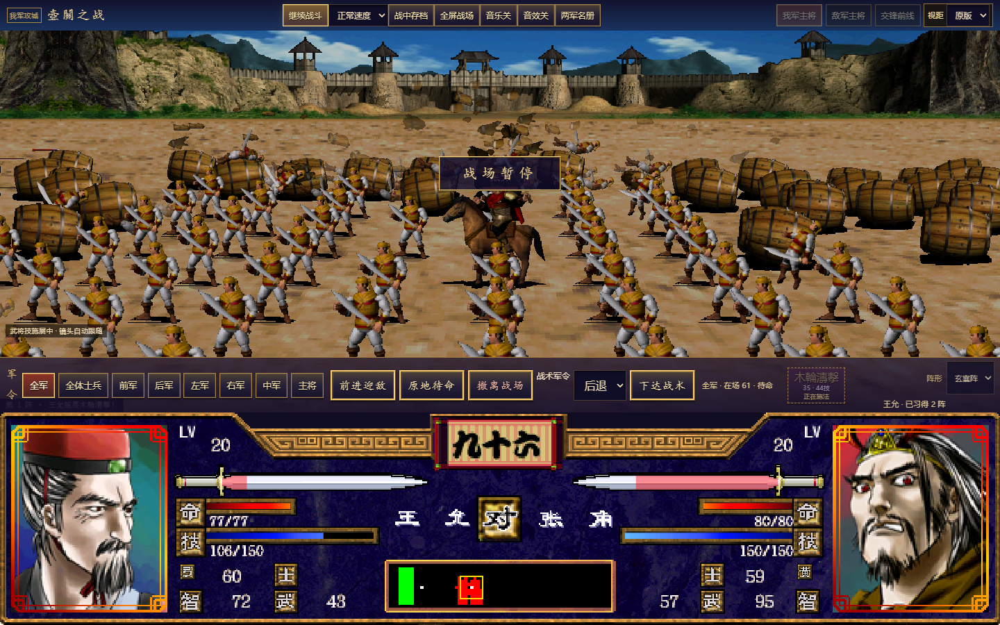

# 战役、战功、滚木与声音 · 2026-11-26

这轮开发补的是会改变战局的实际流程：电脑互战双方决策、每阵战功与整军经验结算、年度人物出场、滚木三技，以及原 WAV 事件播放。所有入口都已接入真实战役或战场，保存的状态可以继续执行；没有把纯函数或素材导出单独算作完成。

## 电脑交战与战后成长

电脑互战现在与玩家战役共用武将运行属性、装备外观、当前兵种和兵槽。双方分别保存战术观察和倒计时，使用同一原版随机流执行选将、军师、选阵、选技、推进和撤退。移除了进攻方固定前进和九阵截断，轮战至一方无可用将；伤势、技力、兵槽、士气、疲劳、忠诚和战绩回写战役。

战功链来自 `0x43A1C4 → 0x41048D → 0x410989 → 0x40FA92`：每轮在军师技前保存初始现役/预备兵，结算敌军伤亡、击倒、撤离或日暮的战功；交锋结束后，胜方全部名单分享胜奖，双方全部将领再按累计战功获得经验，同时更新势力累计战斗经验。升级保留伤势、技力损失和兵员。三档“增加经验”军师技按原标志8192与30/50/100修正接入，军师技有入口记录从52/67增至55/67。

原日暮与双方同倒会使双方当前将退出本次轮战。双方名单都耗尽时，保留战略守城结果，但经验按原平局处理：不发胜奖，也不加胜败士气/忠诚。旧战中存档缺少战功标记时，保留原结算，不补造不存在的历史战功。

## 年度人物与城景

[年度人物专项](NATIVE-OFFICER-APPEARANCE-2026-11-26.md)记录五时期POS、概率与强制年、BLOOD亲族归附、同年链、满城转移和原成长抽签顺序。年度入口按人物出场→清行动→电脑内政→税收执行。

原城景 `0x40EA29` 按实时城市容量分类，不再固定使用初始城景。`0x4366C4` 的随机选择已纠正为奇数A、偶数B；固定A/B不消费随机数。景色进入战斗后随存档冻结，人口变化不会改写进行中的场景。

## 滚木三技

滚木、滚木雷、滚木压分别调用脚本506/518/535，恢复1/2/4波，每波19根滚木。实战使用原对象49001及碎片49002–49008、固定点移动、点占格碰撞、回调39001、暗场、镜头、等待和淡出。移除了三个技能的通用范围伤害。

同一根滚木可以在原延迟音效回调挂起时再次进入碰撞回调；碎片可能再次生成，整次施法对敌将仍只造成一次伤害。这一细节已由原VM重入样本验证。碎片等待节点使用[2,2,2,9999]，保持最后一帧至原对象消失，避免通用动画循环导致闪烁。

## 原版声音

转换器原样导出全部99个PCM WAV，并保存原声音名到本地资源的映射。已移植五类技能的声音宿主、普通士兵受击、主将非致死受伤和防御会产生可存档声音事件，音频不改变战斗随机数。

普通攻击动作数据实际没有音效节点，不能擅自为每次挥刀加声音。原士兵65540回调使用Hit01/255；主将受伤和防御使用原PAIN/DEFENSE首节点的192音量；死亡流没有声音时保持沉默。攻击中的延迟防御声保留等待，目标死亡、逃离或被新动作打断时清理。

浏览器提供独立音效开关，在用户点击后启动AudioContext；WAV按需获取/解码，关闭立即停止。读档、换阵、隐藏页面及已过时的延迟解码不会重播旧声音。播放端当前使用整体音量、最多32个同时声源和1秒过期窗口，这些是Web输出适配，尚未证明与原DirectSound的定位、混音、通道和加速节奏一致。导出99个声音也不代表所有99种事件已绑定。

## 证据与验证

| 范围 | 原码/脚本证据与实战检查 |
| --- | --- |
| 战功与成长 | 400组轮战、120组胜奖、96组整链原机器码样本；另有边界与8项真实战役闭环检查 |
| 军师技 | 860组原x86对照，包含36组新经验策略样本；三档真实战斗倍率检查 |
| 年度人物 | 352组原机器码场景与1项顺序检查；13项战役测试覆盖原剧本、POS时段和存档 |
| 城景 | 99组地形与128组景色选择，共227组原码样本 |
| 滚木 | 57项主流程/回调/并发重入/JSON检查，19项真实战斗检查；浏览器验证原图实际绘制、杀兵、镜头与战中读档 |
| 普通受击声音 | 240组原PAIN/DEFENSE节点、6组原防御请求及原士兵音效/死亡事件顺序；真实sourceTick与延迟防御/JSON检查 |
| 浏览器声音 | 真实WAV解码有非零音频，播放/停止、独立开关与延迟加载跨换阵/读档不重播 |

这些对照运行的是固定哈希的1.05+ EXE/SO。Oracle替代了图形对象、资源播放或部分宿主输入；它们证明指定输入下的规则，不能代替原客户端整局逐帧回放。采样工具位于 `web-port-research/tools/native_*_oracle.py`，提交的fixtures保存在 `packages/core/fixtures/`。

统一验证：**63个核心测试文件、18,386项测试通过；79项Chromium场景通过；6项Python测试通过；TypeScript检查与生产构建通过。** 构建仍提示核心入口bundle大于500kB，未视为功能或复刻验收完成。当天后续已补入道路相遇、战俘/System对白、君主失效及原字库，详见[后续实战记录](NATIVE-MOVEMENT-CAPTURE-2026-11-26.md)。此处数字是此前提交e90b87a的验证记录；85个通用技能、完整UI/音画及SAV兼容仍在[总账](FULL-PARITY-BACKLOG.md)。
