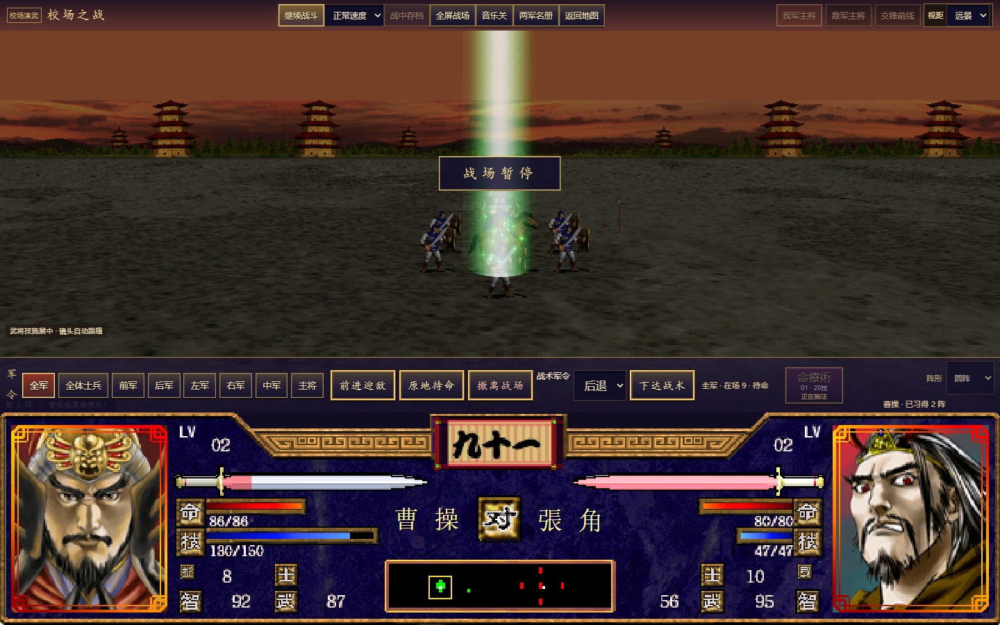

# 命疗术、回天术：原 Heal 与全部子协程

2026-11-19。两个治疗技能已从旧的“施法后立即回血”循环改为原 `Heal` 脚本树。暗场、镜头、延迟、30 个环绕光球、追踪光柱、80 个随机光球、逐点回血和收尾等待均按原入口执行。该差分验证覆盖脚本事件和脚本自己的 RNG；完整战场对象调度、调色板与音效仍需恢复。

## 原码身份与范围

- EXE SHA-256：`1098558aaea96ae552753df786a8d3910df08fda11c8219dfa133ca001d8e419`。
- `SCRIPT_MAGIC.SO` SHA-256：`f2ce3cc23a13c3be18ed4dda2026f5332b1341757cd6ea1aae6adb4086e14565`。
- 命疗术 sequence 1 / script 501 / `Magic1` → `Heal(0)`；回天术 sequence 60 / script 563 / `Magic63` → `Heal(1)`。原配置 `ATTACK` 分别为 30、35，不能从符号数字推断技能 sequence。
- SO：`CreateHolyBall @0x1766C`、`RoundHolyBall @0x178B8`、`IncreaseHP @0x179B0`、`CreateHolyLight @0x17A4C`、`TraceHolyLight @0x17E14`、`Heal @0x17F38`。
- EXE：`0x465700` 每次重新读取脚本列表长度；新创建的上下文在同一次源更新运行，已结束的上下文删除后继续检查当前位置。`0x467320` 的数值等待在注册时已递减一次；`0x465820` 按入口符号名检查等待对象。

## 已恢复的执行过程

以下时点从脚本首次执行记为 0，不是浏览器帧数或毫秒。

| 源更新时间 | 原脚本行为 |
| --- | --- |
| 0–40 | 每 5 次更新降低亮度；40 时完成暗场并锁定施法者，镜头指向其当时的 `(x, y-120)` |
| 40 | host 289 → `0x43AB60`：给单位 `+60` 字段累加 `40×5=200` 的延迟决策；它不是团队集气，也不是动作编号 |
| 60 | host 288 切到 `0x8000` / 原 `SPELL1`，等待 10 次更新 |
| 70–99 | 播放声音请求 `m016snd01`；创建原光柱，连续创建 30 个 `RoundHolyBall`，每个间隔 1 次更新 |
| 100–140 | 等待 40 次更新，然后同次创建 `TraceHolyLight` 和 `IncreaseHP`；创建第一组 10 个光球 |
| 140 起 | `IncreaseHP` 此时记录初始 HP，每 2 次更新写回 `initialHP+i`，达到最大体力后仍保留其余等待；命疗术最后一次写入 198，回天术为 208 |
| 140 起 | 共 8 组、每组 10 个 `CreateHolyBall`；父脚本和子脚本按原列表顺序交错调用原 RNG，包括每个光球的等待、缩放、角度、半径、上升和淡出时间 |
| 140–280 | 光柱先执行 32 次横向缩放，等待 60 次，再缩小并淡出 48 次；父脚本按名字等待它退出 |
| 281–291 | 父脚本恢复，等待 10 次后解锁施法者 |
| 291–391 | 等待 60 次，然后每 5 次更新恢复亮度，最终通知脚本结束 |

原光效 `26001/26004` 和 `26002/26005`、武将与武器的 `SPELL1` 已由转换器读取并用于战场。手机与宽屏共同使用这些素材；Canvas 渲染不调用战斗 RNG。原宿主事件 769 已进入执行轨迹，但本次没有接入它的实际音频播放。

## 差分与集成验证

`web-port-research/tools/native_magic_heal_oracle.py` 在 Unicorn 中执行原 EXE 的整数解释器与原 SO。只替换字符串分配、上下文分配和命名等待的字符串所有权；数值指令、本地函数调用、数值等待和 host 771 原随机函数照常执行。图形、对象与 HP 宿主使用明确的合成边界；脚本列表按上述原循环迭代。

72 组样本覆盖两个技能、双方方向、靠近两端及中央的位置、濒死/受伤/满血，以及两组双字随机种子。合计 **28,224 次源更新**，逐项比较所有宿主事件、子协程创建、每次 HP、每次 RNG 和活动上下文数量，结果一致。原 EXE/SO 留在本地，公开仓库只保存样本和复现工具。

战场集成另外验证：施法等待期间体力不提前增加；在 `IncreaseHP` 开始时才捕获初始 HP；并发改变 HP 后仍按原快照写回；满血时保留全部脚本等待；host 289 更新延迟计时；10 个不同保存时点恢复全部子任务与随机状态；非法任务、资源、所有者和规则标记被拒绝。新的 `healRules: native-heal-v1` 只在新战斗启用，旧 Web 存档保持原循环。

浏览器验证覆盖命疗术桌面 1440×900、回天术手机 390×844，检查真实原素材的 `drawImage` 调用、亮光混合、脚本镜头、暂停/缩放期间计时不变，以及施法结束后交回镜头控制。

## 尚未达成完整一比一的部分

1. 本次脚本差分没有执行真实原游戏的混合对象链。宿主调用轨迹相同不能证明实际战斗中的其他单位 RNG 和脚本 RNG 在全局上交错一致。
2. 光效绘制接入原素材和宿主参数，但对象生成/更新的全局先后、精确尺度衰减、DirectDraw 调色板和逐像素图像仍缺原客户端截图/录制基线。
3. 原治疗声音请求尚未实际播放；完整武将施法、受伤和死亡动作与战斗结束的交互仍需核验。
4. 其余 97 个技能仍使用暂定通用执行器；另有 7 个 MoreSoldier/BackSoldier 增兵技能已接入局部原 VM 边界，但尚未完成全局对象顺序、视觉和音效验收。完整列表见 [110 技能清单](MAGIC-COVERAGE-2026-11-19.md)，全范围差距见 [当前复刻状态](PARITY-STATUS-2026-11-19.md)。

复现：在 `web-port-research` 运行 `.venv-ai/Scripts/python.exe tools/native_magic_heal_oracle.py`，再在 `sango2-web` 运行 `pnpm exec vitest run packages/core/src/native-magic-heal.test.ts packages/core/src/battle-native-heal.test.ts`。全量验证日志保存在 [commands](evidence/commands/)。
