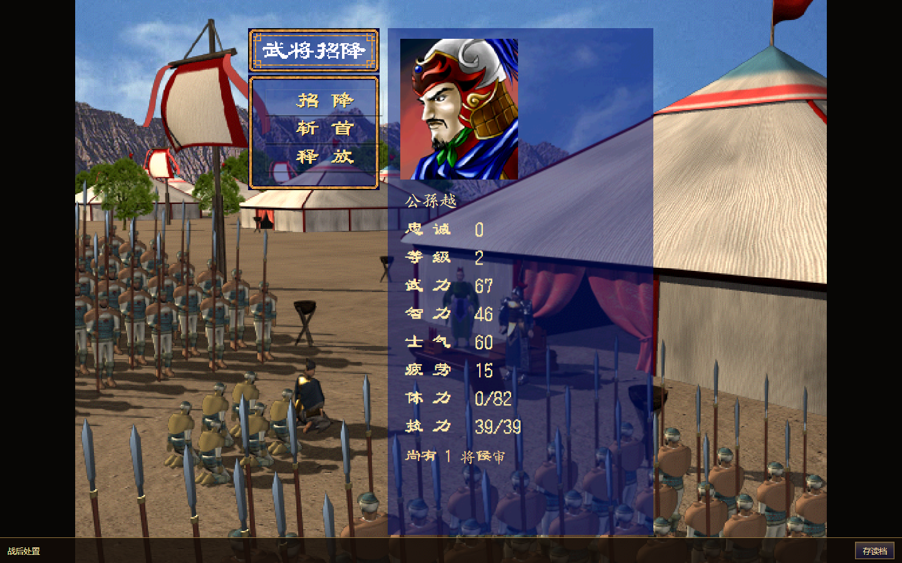

# 原行军、道路相遇与战俘处置

本轮在真实战役中接入原军团行军和道路相遇，补齐招降、释放、斩首到归属变化的流程，并恢复原SYSTEM对白、君主失效判定及部分原字库。旧Web存档保留旧旅行/结算标记，新原资料战役启用对应原规则。

## 实际行军与相遇

新军团保存16.16坐标、原方向、路点、下一城/目的城、动画节拍、军资、撤退次数和免战/停驻计时。常态每六次源更新移动约1像素；败退速度为3。六更新之间仍检查路点和计时，不能将速度简化成每回调1像素。

`0x406169 → 0x40E515 → 0x439A48 → 0x40E86F` 在建议移动位置检查军团的原AABB，两轴固定点半宽总和8像素；不同道路的军团也可能相遇。同阵营或仍在免战期时不入队，每次最多16对，同一对象不同时参与两场。`0x41152C` 先结算电脑战，最后进入本次最后一场玩家交战。

道路战使用双方真实坐标的整数中点，从四季CHINAMAP掩码采样地形；无城防，也不把军团的最终目的城当作交战地点。屏幕上玩家始终在可操作侧，保存的firstSide保留原碰撞队伍顺序，供经验和后果结算使用。双方轮战、原技能与经验走同一战斗内核。

胜军原地停驻240更新、免战20；败军免战60，另有原随机停驻/军资损失和退路抽签。败军继续沿路撤离，不立即回城。归附原地组的入城条件与中途退回上一城明确区分，防止退军在道路中段被当作已经抵城。满城时军团留在城外，兵员和军资保留。

一个战略日仍按10个源回调呈现；途中进入战斗会保存callbackInDay，读档和结算后从该日未完成的回调继续。当前未证明与原客户端全部地图精灵、城市及脚本混合列表顺序一致。特殊道路已参与原寻路，所有版本/历史/设置条件仍待逐条验证。

## 俘将与原脚本

击倒只写轮战status3，尚不等于处决。正常胜负后按原名单顺序处理：电脑按`0x40452E`；玩家按`0x44E820`预先调用`0x404344`，保存该俘将是否愿降与原因。重复招降不能刷新这个结果，但每次原对白仍会消耗其自身台词随机数。

玩家选择后执行`SYSTEM.SO`原KillGeneral/FreeGeneral/YieldGeneral词码。对白宿主10/3会阻塞脚本，翻页后下一源更新才抽后续台词；最后20更新等待结束才进入521/528/529回调。成功音SUCCESS使用原255音量。对白、指令位置、值栈、等待、当前俘将和随机流全部随Web JSON保存。

全部处置结束后才发经验与更新归属，势力累计归原参战势力。原status5从所属名单移除并标记退出，装备与兵槽不擅自归库或清零；年度人物处理不会将其复活。status6保留伤势、兵槽和装备，忠诚至少50时变为原值的三分之二，再建立单将归附军。道路战归附目的城依原胜军lastCity；原412099直接在该目的城坐标建组，再执行入城。败城余将每5人一组建撤军。

原版没有在这些路径另选一个继承人：指定君主的所属变更后，旧势力不再满足40975E；残军转盗贼。尚有别城的非玩家君主可按原分支逃城。41B643/41B699先检查有效敌君主是否尽失，再判断玩家君主是否失效，据此进入统一或失败页面；可保存或重新开局。原结局影片与其他历史演出仍未齐。

## 原界面与字库

俘虏画面使用原YIELD.SHP、配套YIELD.TEX、D8_A/D8_B。菜单坐标由EXE数据读取：左菜单147/24/112/138，右资料266/24/226/432；三个按钮相对15/52、15/76、15/100。TEX提供原窗口后的暗色纹理，姓名/头像使用原绘制区域。宽屏保持640×480比例，手机另行重排，不把响应式布局称为原像素一致。

[原字库专项](NATIVE-BITMAP-FONT-2026-11-26.md)区分原bitmap与WOFF2：战场姓名使用原二值字形，原字号/整数坐标下44字形的逐像素比较为零差；DOM字体虽保留原字形和字宽，浏览器仍会平滑。全部窗口、原对白逐字显示、关闭淡出及结局画面没有完成原客户端逐状态验收。

## 证据与验证范围

| 范围 | 证据 |
| --- | --- |
| 战略规则 | 240碰撞、160队列、240路点、160后果、200方向/速度、240退路、240精灵更新、180寻路原x86样本，另有真实dispatch/轮战/JSON检查 |
| 俘虏规则 | 788项原判定/AI/预掷/归附/扣罚检查，含96组败将额外扣罚；实际攻守、君主与名单写回 |
| SYSTEM俘虏脚本 | 144组原VM样本及6项等待/存档边界，共150项；每更新宿主、随机流和对白等待比较 |
| 原字体 | 275组原索引/绘制函数样本、3项Python、4项Chromium；明确报告WOFF2平滑差异 |
| 浏览器 | 俘虏桌面/手机/终局3项，原行军/道路战4项，原字体4项；均重建实际内容与存档，不依赖缓存fixture |
| 箭雨 | 六技已接实战，405项内核、19项战斗、2项浏览器；见[ArrowSupport专项](NATIVE-ARROW-SUPPORT-PARITY-2026-11-26.md) |

原EXE哈希沿用[总账](FULL-PARITY-BACKLOG.md)。SYSTEM.SO SHA-256为`695a2a2e502d5c34a061cd5f60a3aba358bbfbb4854c18d51cc8c6905c42a92a`。原VM/机器码对照使用合成宿主输入，不能替代原客户端同存档、同输入、整局连续回放。

第二批检查：完整工作区76个核心测试文件共22,221项通过、1项跳过，其中包含下一批尚未接入实战的Spout和劝降脚本内核，不计入本批功能覆盖。Chromium整套92项初跑90项通过；满兵施法在加载完成等待调整后单项通过，30人占空城/存档流程定位到测试中Vite整页重载后，独立及3工作进程压力复跑共12次通过。俘将界面在截图复核后将原字库缺失的简体标签改回原繁体字，避免系统字体混排，并显示实际装备加成后的武力/智力。10项Python检查、类型检查与生产构建通过。全部检查均为本地验证，不代表原客户端整局验收。

当前25/110武将技接入局部原流程，85项仍为通用替代；军师技仍按已发布入口统计。原SAV、完整系统事件、特殊布阵/劝降等尚未完成项继续记录在[总账](FULL-PARITY-BACKLOG.md)。
