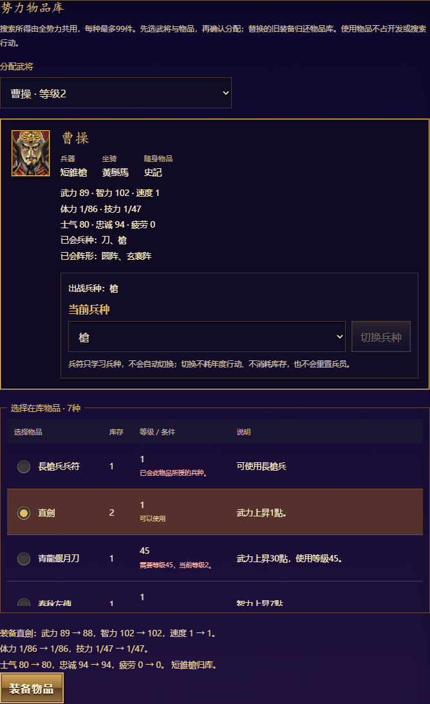
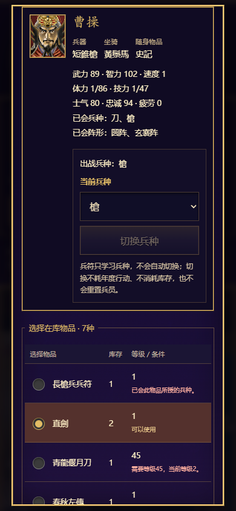

# 玩家物品分配、使用与卸装对照

本次补齐了物品库的玩家操作：选择本城武将、查看全部库存与使用条件、预览属性、确认使用或换装、卸下随身物品。搜索所得可实际用于武将，装备属性进入内政开发、实战人物与名册；库存和学习结果可随存档恢复。

**这项工作验证的是玩家物品执行函数及 Web 操作流程，不能代替完整游戏一比一验收。** 原物品窗口的布局、外围菜单开放时机、原兵种切换事件和特殊坐骑仍须分别核对；[当前兵种选择已贯通Web实战与存档](TROOP-SELECTION-2026-11-19.md)。



截图来自真实浏览器操作。测试存档提供指定库存，并将曹操设为受伤状态，以便核对换装、重复学习、君主赏赐限制与读档；这些库存和伤势不是普通新局配置。

<details>
<summary>查看手机上的物品操作</summary>
<p align="center"></p>
</details>

## 原版依据

目标 EXE：`web-port-research/evidence/ida/Sango2.exe`；SHA-256：`1098558aaea96ae552753df786a8d3910df08fda11c8219dfa133ca001d8e419`。静态导出位于 `web-port-research/evidence/ida/static-export/`，以下函数均有对应的八位小写地址 `.c` 和 `.asm.json` 文件。

| 函数 | 已确认并移植的行为 |
| --- | --- |
| `0x4243CE` | 依编号列出有库存的物品；不合资格的以负数量标为不可用，仍留在清单；随身物品槽非空才追加编号0“卸下” |
| `0x424509` | 玩家完整执行入口：资格检查 → 消耗品直接应用/装备卸旧后应用 → 旧装归库 → 新物品扣库；编号0只卸随身物品 |
| `0x4086F1` / `0x408710` | 前者读取完整 flags，后者仅保留分类高位；玩家用完整 USED 位判断消耗品，不能照搬电脑年度的分类分支 |
| `0x408E0E` | 等级不足拒绝；所授兵种或阵形与已会掩码有任何重叠即拒绝；LOYAL非0的物品不允许君主使用 |
| `0x406FEB` / `0x407057` | 按分类卸旧，再应用新物品；没有任意槽位“全部卸下”操作 |
| `0x4088FA` / `0x408BDC` | 16位属性加减；体力、技力夹在1与当前最大值之间；士气、忠诚、疲劳夹在0～100；卸装不撤销已学兵种和阵形 |
| `0x409793` / `0x4097EA` | 归库最多99，库存大于0才减；编号0不入库、不扣库 |

两条容易被“优化”错的原行为已保留：

- 换装先卸旧再穿新。卸下增加最大体力的旧物品时，当前体力会先被降低后的上限夹住；新装备不会把这部分体力补回来。预览也执行相同中间步骤。
- 同一件装备可以再次替换。若其库存为99，先归库仍为99，再扣新物品后为98；没有改成普通交换守恒规则。

## 代码与存档

- `packages/core/src/native-items.ts`：`nativePlayerItem` 对应原执行内核，与电脑年度入口分开。
- `packages/core/src/native-player-items.ts`：在分离的状态副本上执行预览；检查编号、库存、等级与资格，并处理旧预览存档的装备属性基线。
- `packages/core/src/native-policy.ts`：`policy-item` 命令检查城池归属、本城在任武将与行军状态；战中由现有总入口拒绝。失败不修改调用者状态、不扣库存。
- `apps/game/src/PolicyInventory.tsx`：目标武将、当前装备/数值/已会兵阵、在库清单、限制原因与确认按钮。选择本身不扣物品，提交后才执行。

操作使用现有装备槽、运行属性、兵阵掩码和势力库存，不新增存档格式。物品不抽随机数，也不花费或恢复年度开发/搜索行动。唯一物品的已发现标记保留；卸装不会让它重新进入搜索池。

Web 当前把入口放在“内政经营 → 物品库”，仅选择本城驻守的己方在任武将，内政结束后仍可打开。**这些外围入口和限制是 Web 适配**：`0x424509` 本身不检查驻城和年度阶段，尚未完成原脚本菜单调用者的完整时序取证，不能把这部分标为原版一致。

原包77件物品的实际配置包含兵器、坐骑、随身物品、兵符、阵书与忠诚赏赐。本次没有为了填充界面创造原包不存在的恢复或疲劳道具；通用HP/MP/疲劳等字段的运算由原码样本单独覆盖。

## 验证

生成原码样本：

```powershell
.\web-port-research\.venv-ai\Scripts\python.exe web-port-research/tools/native_player_items_oracle.py
```

生成器执行原 `0x424509`，保留其内部资格、卸装、应用、库存和原RNG函数；仅替换三个格式化文本、排入消息的通知回调 `0x408818/0x408865/0x4088B2`。384组固定样本覆盖武器/坐骑/随身物品/消耗品、空槽/有旧装、等级拒绝、重复兵阵、君主赏赐、归库上限、同件替换、编号0与有符号溢出，并逐组比较人物、库存及RNG。它们是隔离快照，不是原客户端窗口或整局回放。

`native-player-items.test.ts` 另逐项验证原包全部77件物品的命令提交与读档，覆盖非法输入、库存不足、敌将/行军/战中拒绝、旧局装备基线、已学兵阵保留，以及新装备实际改变开发收益与真实出征的战斗人物和外观。

`tests/player-items.spec.ts` 在1440和390宽度通过真实界面导入测试存档，完成键盘确认、换装、卸装、学习、重复使用拒绝、君主赏赐拒绝、导出/导入一致，以及内政结束后继续换装。复用了明确等待导入完成的 `CouncilPage`，没有固定延时等待。

物品接入时全量验证：43个核心测试文件、14,701项测试；54个Chromium场景；6项Python测试；类型检查与生产构建通过。后续兵种选择的最新验证见[兵种选择记录](TROOP-SELECTION-2026-11-19.md)。

## 仍需完成的物品差距

1. 原物品窗口640×480的排版、字库、选择方式及状态截图基线。
2. 原脚本外围菜单开放阶段、可选对象、驻城与行军限制的完整调用链。
3. 主动兵种选择已在Web接入，当前兵种与已会掩码分开保存并贯通实战；原切换事件、兵员转换与原窗口仍待连续客户端核对。兵符不自动改变当前兵种；阵书学习已接既有布阵选择。详见[实现及边界](TROOP-SELECTION-2026-11-19.md)。
4. 特殊坐骑的禁退/免疫与相关军师技冲突、跨轮生命周期。普通速度与装备外观已贯通，但不据此宣称特殊效果完整。
5. 同一原客户端存档的连续搜索、分配、战斗、掉落/死亡装备去向与再次读档对照。完整任务见 ITM-01～04、GEN-05、POL-12。
