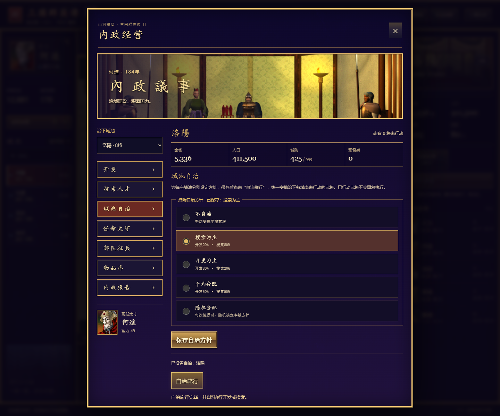
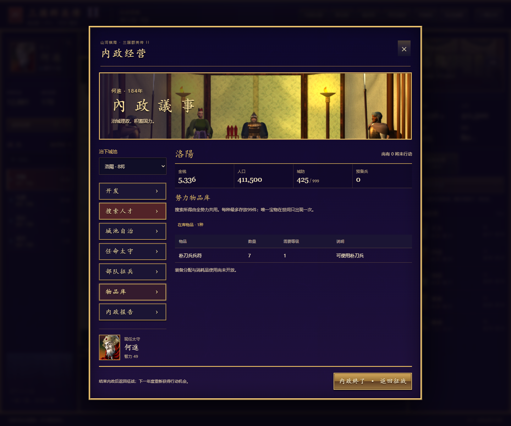

# 搜索、登用成长与城池自治

后续更新：电脑年度四段、普通升级、运行装备与属性见[年度内政对照](NATIVE-POLICY-ANNUAL-PARITY-2026-11-19.md)。下文保留本次搜索功能交付时的记录，装备与年度AI边界以该后续文档为准。

2026-11-19。本轮把此前缺失的搜索、人才归附、物品库存与自治接入可玩的年度内政，同时修正新局兵员初始化。**这些功能已有原函数差分依据，完整内政和整个游戏仍未达到一比一验收。**

## 玩家现在可以做什么

- **搜索人才**：选择本城未行动武将，批量寻找在野人才与物品。开发、搜索共用年度行动；没有成果也会记为已行动。
- **城池自治**：逐城保存搜索为主、开发为主、平均分配或随机分配，点击「自治施行」后，安排治下各城尚未行动的武将。可随时改回不自治。
- **查看物品库**：所得收入全势力库存，每种上限99。唯一宝物已出现后退出搜索池，初始装备也会登记。
- **查看搜索报告**：记录搜索人、城池、年度、发现物品、拒绝或归附、升级结果，最近100条随存档保存。
- **使用成长后的武将**：归附经验会实际改变运行等级、体力/技力上限、统兵上限及已学技能。实战、AI可战判断、名册和配兵均读取运行值。

新局使用原等级派生的现役和预备兵槽。例如2级是10现役、0预备，30级是100现役、50预备；不再固定每将80兵。城市初始预备池为0。已有存档不会重新发兵、截断兵员或重置行动与随机状态。

<table>
  <tr>
    <td></td>
    <td></td>
  </tr>
</table>

截图取自实际浏览器流程。库存截图使用只保留一种掉落、暂时关闭在野人才的测试配置，便于检查数量与保存；正常游戏保留全部77条物品和原人才数据。截图不作为原客户端像素验收。

## 原程序规则与处理顺序

| 环节 | 原函数 / 字段 | 已实现的行为 |
| --- | --- | --- |
| 城市搜索类别 | `0x42D8F0`，城市+108 | RATE合法范围1–5，超界回落3；原二进制的五行均为50/30/20/33/66 |
| 搜索主分支 | `0x426D8C` | 人才50、物品30、无结果20的相对权重；不是固定“搜索成功率” |
| 邻城选择 | `0x4010C6/0x4054B9` | 本城占两个抽签位置，各邻城一个；最多邻城数+2次重试；跳过FLAGS==1的隐藏城，搜索不按Web行军的长道路禁用规则排除邻城 |
| 在野名单 | `0x405DA8/0x405F38` | 全局人物链顺序筛出目标城STATUS==8的人；从人数+1个位置抽取，最后一格为没有发现 |
| 无在野人的特殊分支 | `0x426D8C` | 原函数仍抽66:33，但丢弃结果，然后必定转向物品；保留这次随机消耗 |
| 登用判定 | `0x426C69` | 情义势力就是执行方时结果17；故主仍执掌旧势力则19；故主已改仕执行方则16；其余按候选智力权重60或INT−30与40抽签，得到16或拒绝18；执行将智力不参与 |
| 归附经验 | `0x426B44/0x409B66/0x407EC9/0x4080E4` | 玩家在任人物按经验降序、君主移首位，取前1/3至少1人的平均；按原整数顺序取3/4，再乘90–119% |
| 升级和恢复 | `0x409EE0/0x409F0F/0x40F23C` | 逐级升级、保留原最大体技力的派生差值；每次真正升级后填满两兵槽和体技力；经验可以下降，但不降级；没升级不免费恢复 |
| 物品选取 | `0x408EE2/0x408EA6` | 128个槽，未配置槽权重0；SEARCHTYPE1的等级±4窗口及距离除权，TYPE2低等级窗口与达到等级后全权；ONLYONE已出现就权重0；空池返回−1 |
| 初始物品登记 | `0x42D05D/0x42D100/0x42CFBA` | 人物预装备不论是否达到装备等级都登记found；包括尚未登场的人物 |
| 库存 | `0x409793` | 搜索成功收入执行方库存，上限99；满库存后仍消耗此次搜索与物品随机抽取 |
| 自治分配 | `0x427701` | 开发权重20/80/50/随机20–79，其余为搜索；按城市和人物遍历；已行动者不抽行动签；随机方针即使全城已行动仍抽一次城市权重 |
| 新局兵员 | `0x42D1A3/0x409FB6/0x409FD8/0x42D8F0` | 初始化时两兵槽填至等级上限，城市预备池+134为0；城池显示驻城在任将领兵数合计 |

**本修正版的字段陷阱：** `0x42D4C2` 的机器码明确传入字符串`LOYAL`，随后按势力名称查找，写入情义势力指针。原包401人的这个字段都是数值或空，实际解析均为null；没有擅自把`LOYALKING`当作它的替代。代码保留16/17/18/19完整分支，合成人物关系分别验证。这是该固定版本的实际行为，不能拿其他版本的配置约定覆盖。

原全局人物建立是尾插（`0x4068EB`），城市驻将和势力人物是头插（`0x4056B7/0x40962B`）。本轮搜索在野名单使用原配置人物顺序，初始驻将反序，搜索归附放在当前城名单首位并标记已行动。道路按`PATH000…128`加载（`0x42DF10`），依次填城市邻槽（`0x422CCE/0x405939`）。后续Web行军的完整链表变更仍有适配边界，见下文。

## 原x86差分与游戏验证

固定EXE SHA-256：`1098558aaea96ae552753df786a8d3910df08fda11c8219dfa133ca001d8e419`。

[native_policy_search_oracle.py](../../web-port-research/tools/native_policy_search_oracle.py)使用Unicorn隔离执行上述原函数，不启动Windows游戏。样本保存在[native-policy-search.json](../packages/core/fixtures/native-policy-search.json)，TypeScript对照见[native-policy-search.test.ts](../packages/core/src/native-policy-search.test.ts)。

| 样本 | 数量 | 真正执行和替换的边界 |
| --- | ---: | --- |
| 物品权重/唯一标记/等级 | 240 | 原`0x408EE2/0x408EA6`及RNG直接执行，无决策替换 |
| 搜索与原邻城/名单辅助 | 180 | 原搜索主函数和名单辅助；仅用内存分配适配替换malloc/free，登用回调只记录候选并返回18；回调内部另外验证 |
| 16/17/18/19登用分支 | 160 | 原`0x426C69`及RNG；加入/成长副作用替换为空回调，避免创建地图精灵 |
| 经验名单与逐级成长 | 100 | 原`0x426B44`、原经验排序/君主置首/升级和RNG；仅malloc/free适配；合成样本的学习表为空，真实学习表另由既有技能学习测试覆盖 |
| 自治调用顺序 | 100 | 原`0x427701`及RNG；替换显示消息和开发/搜索动作回调，记录调用序列；回调内的随机消耗由独立开发/搜索样本及Web集成验证 |

合计**780组**，逐组比较结果和完整双字RNG。它们不能证明整条Windows客户端搜索动画、地图对象创建或完整年度流程已经等价。

浏览器专项覆盖1440和390宽：选择/搜索、共享行动、显式保存自治、施行、库存、报告与导入导出；原配兵流程增加导入一个真实合法伤兵状态再补兵的检查。本轮41个核心测试文件、13,382项测试，完整Chromium51项、最终内政专项5项、Python5项、类型检查和生产构建通过；完整回归、构建和Python结果见[命令日志](evidence/commands/)。

## 仍须继续补齐

1. **AI年度处理尚未接入。** `0x402711`的搜索/开发、两段经验追赶、使用物品/换装必须完整恢复；不能只接第一段就称原年度AI已经一致。
2. **完整装备系统仍缺。** 武力、智力、最大体力/技力及消耗品效果未全部闭合。本轮成长在Web当前属性输入上调用原派生规则；当原装备属性尚未进入输入时，整个人物的最终数值仍可能不同。
3. **原系统对白与事件未接。** 搜索报告使用Web文本；SearchTalk、成年/出场、原年度先后、结束内政是否触发自治的完整原菜单调用链、历史事件和特殊开关仍须取证。当前自治由独立按钮显式执行。
4. **连续对象顺序仍未全相同。** 搜索归附维护头插顺序；跨行军、城市易手和返城的完整原链表维护尚未完成，现用驻城状态同步适配。原自动太守接任也仍是已声明的兜底。
5. **玩家搜索已允许满城登用，AI满城另选城市的分支待随年度AI接入。** 当前命令只允许玩家，不能把玩家的落城方式套给电脑。
6. **战后经验、俘虏与势力结局未齐。** 归附成长已实现不代表所有成长来源和整局循环完成；77物品已可搜索入库不代表已经能分配、装备或使用。
7. **原640×480界面与音画未验收。** 当前沿用宫殿原素材与Web响应式布局；没有取得全部同状态的原客户端截图，仍不能称UI百分百还原。

全部对应项保留在[一比一总账](FULL-PARITY-BACKLOG.md)，没有删去尚缺的功能。
