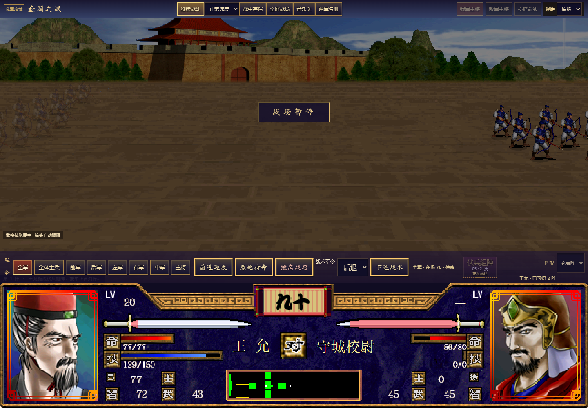

# 伏兵与后伏：增兵脚本、兵员槽位与战后结算

2026-11-20。七个增兵技能已接入原 `MoreSoldier` / `BackSoldier`、`ProduceSoldier` / `ProduceBackSoldier`、`StepShow` 和往返镜头。新兵是真实战斗单位，参与占格、分队军令、攻击、死亡和战后兵数结算。满兵时也保留原版施法失败流程，不再由 Web 按钮提前拦截。

本次分别验证原解释器中的脚本事件和原机器码中的兵员宿主。两类证据的替代边界不同；它们仍不能证明整场战斗的混合对象链、音效和像素画面已经一比一。

## 目标版本与技能范围

- EXE SHA-256：`1098558aaea96ae552753df786a8d3910df08fda11c8219dfa133ca001d8e419`。
- `SCRIPT_MAGIC.SO` SHA-256：`f2ce3cc23a13c3be18ed4dda2026f5332b1341757cd6ea1aae6adb4086e14565`。

| sequence | 技能 | 原包装器 / script | 共用入口 | 单次请求上限 |
| --- | --- | --- | --- | --- |
| 5 | 伏兵组阵 | `Magic9` / 509 | MoreSoldier | 17 |
| 17 | 伏兵排阵 | `Magic23` / 523 | MoreSoldier | 32 |
| 57 | 伏兵班阵 | `Magic65` / 565 | MoreSoldier | 25 |
| 81 | 伏兵连阵 | `Magic84` / 584 | MoreSoldier | 42 |
| 19 | 后伏连兵 | `Magic24` / 524 | BackSoldier | 25 |
| 31 | 后伏兵阵 | `Magic33` / 533 | BackSoldier | 35 |
| 37 | 后伏军阵 | `Magic41` / 541 | BackSoldier | 45 |

SO 入口：`MoreSoldier @0x5380`、`BackSoldier @0x20EB0`、`ProduceSoldier @0x4EF4`、`ProduceBackSoldier @0x20A24`、`StepShow @0x3A60`、`MoveCamera @0x1390`。包装器名称中的数字与 sequence 不同，不能互相替代。

## 原脚本的执行过程

以下时间从第一次脚本执行记为 0，单位是原程序源更新，不是浏览器绘图帧。

| 源更新 | 已接入的行为 |
| --- | --- |
| 0–40 | 每 5 次更新降低亮度；40 时进入暗场，锁定施法者，读取其当时坐标并把镜头指向 `(x, y-120)`。host 289 增加 `40×2=80` 的延迟决策 |
| 60 | 读取等级和当前存活士兵数；请求数为 `max(0, min(技能上限, min(等级,40)×5-存活兵数))` |
| 60，能够增兵 | Produce* 从本方或敌后方向扫描战场；每次创建成功后立即占格，再继续扫描，随后创建 StepShow 子协程 |
| 60，无法增兵 | 执行 CastFail，使用双方各自的朝向，立即解除主将锁；保留耗技力、等待和亮度收尾，共 169 次更新 |
| 84 | 正常增兵路径切换施法动作并解除主将锁 |
| 90 | 发出两条原声音请求并启动 40 次更新的 MoveCamera。MoreSoldier 在父协程中调用；BackSoldier 追加子协程，因此同次更新内的镜头与 StepShow 顺序不同 |
| 90–240 | StepShow 在自己的等待后每 10 次更新写一次透明度；240 时写入 16 并清除 `0x40000` 显隐标记，不再停在半透明的 15 |
| 230 / 231 起 | 镜头用 20 次更新返回施法者当时的位置；BackSoldier 的命名子协程等待使返回比 MoreSoldier 晚一次更新 |
| 258 / 259 起 | 恢复亮度，最后交回普通镜头控制；固定样本中的正常路径分别共 299 / 300 次更新 |

扫描使用原 71×14 占格区域；纵向顺序是 `7,6,6,7,5,8,4,9,3,10,2,11,1,12`，中间两行会再次检查。原循环还会走到横向 `-1` 或 `71` 的哨兵位置。原宿主会发出非法坐标警告，但仍创建士兵：两组机器码样本分别产生横坐标 `-48` 与 `6864` 的对象，返回有效句柄；不能将这条警告误写成拒绝创建。已有对象占格或兵员记录占满时，宿主才返回 0。

每次空格分配请求都消耗一次技能请求数，即使 host 281 返回 0。原脚本仍会对子句柄 0 创建 StepShow；Web 保留其脚本状态与事件，但不会生成一个虚假的存活单位。

## 士兵对象与战后兵槽

| 原机器码 | 已接入规则 |
| --- | --- |
| host 281 `0x42068C` → `0x43A971` | 每方最多 200 个士兵记录；按记录顺序复用第一个带删除标记的槽位，再考虑追加记录。占满时返回 0 |
| `0x442A1A` | 新兵归入原分队 1，继承该分队军令及本方主将的决策计数；依本方实际兵种建立现役士兵，弓、弩和飞刀兵保留远程属性 |
| `0x43DB0D` / `0x43B556` | 死亡立即使士兵记录可复用，不必等屏幕上的尸体或淡出对象消失。尸体、投射物和新兵仍使用不同对象 ID，避免存档引用指向另一名士兵 |
| `0x443D29` | 战后分别统计现役与预备士兵，再各自按等级容量截断。现役超额部分不会自动转入预备槽 |

新兵通过真实 `nextId` 立即加入 `BattleState.units`，下一次扫描能够看到刚生成的占格。等级决定的补兵目标和 200 个记录槽限制分别生效。旧 Web 存档留在场外的溢出兵仍是兼容数据，不计入原 host 268 的存活对象数。

这次同时修复了连续施法、已有现役兵达到 100 后的增兵、死亡槽位复用、轮战兵数预算和战后 HUD 读取。轮战与战役最终接收的现役、预备数量来自截断后的兵槽。

## 两类原码证据

| 证据 | 样本数量与比较内容 | 原码与替代边界 |
| --- | --- | --- |
| [脚本 oracle](../../web-port-research/tools/native_magic_reinforce_oracle.py) / [脚本 fixture](../packages/core/fixtures/native-magic-reinforce-vectors.json) | 140 组等级、人数、双方向与占格组合，另 28 组分配拒绝；168 组逐项比较全部 host/child 事件及顺序、生成位置/句柄、最终镜头、源更新数和 RNG | 整数 VM、原 SO、等待、调用及子协程迭代执行原程序；等级、存活数、占格、分配、图形和声音为合成宿主。28 组只证明宿主拒绝之后的原脚本行为 |
| [宿主 oracle](../../web-port-research/tools/native_reinforce_host_oracle.py) / [宿主 fixture](../packages/core/fixtures/native-reinforce-host-vectors.json) | 632 组分配：13 兵种、双方、军令、空槽/满槽/删除槽/尸体/撤退、坐标和主将计数边界；另 2 组死亡后立即复用、56 组战后现役/预备结算 | 原分配入口、占格检查、记录选择、初始化与军令继承执行原机器码；只替代渲染对象分配 `0x4217FE` 和非法坐标提示 `0x450260`。战后 `0x443D29` 对合成兵员记录执行，无函数替代 |

脚本中的“全占格仍调用哨兵”与原宿主中的“警告后继续创建”分别保留。独立宿主样本还验证已有对象占格时返回 0；警告、拒绝和创建没有合并成一条 Web 自定规则。宿主返回的结果并未反过来改写原脚本样本；测试也没有使用 fixture 执行技能。

## Web 战场与存档验收

[脚本专项测试](../packages/core/src/native-magic-reinforce.test.ts) 核对上述 168 组轨迹、成功路径的主将锁、逐步镜头、完整显现及 JSON 恢复。[战场专项测试](../packages/core/src/battle-reinforce.test.ts) 继续核对真实对象、远程兵种、分队/计数继承、重复施法、槽位、死亡复用、结算和旧存档。[真实接线的宿主差分测试](../packages/core/src/battle-reinforce-host.test.ts) 已通过 690 项，逐项将 632 组分配、2 组死亡复用及 56 组结算的原机器码输出与实际 Web 接线比较。

[Chromium 场景](../tests/battle-native-magic.spec.ts) 覆盖两条实际 UI 路径：满兵施放后扣除技力、不生成新兵并交还镜头；真实出征后施放增兵，在暗场和新兵显现过程中通过存档界面保存，刷新页面后读取，核对更新游标、镜头、亮度、调色板和新兵数量，再继续直到完全显现与收尾。截图来自这条真实战役路径。

另已复现并修复 `battleScenePoints` 在增兵或保留尸体后重新按初始阵形人数布阵而越界崩溃的问题。全部单位已有保存的移动或尸体坐标时，绘制和小地图直接读取这些坐标；缺少坐标时才读取部署表，避免把补兵当成重新开阵。[战场增兵回归](../packages/core/src/battle-reinforce.test.ts) 验证连续生成与尸体保留，[场景回归](../packages/core/src/battle-scene.test.ts) 继续验证初始布阵预览与缺失坐标的兼容。

首次接入版本使用过独立的合成句柄；读取仍在施法中的这类旧快照时，会先把原 runtime 中的句柄连接到已有战斗对象 ID，再继续执行。旧快照中遗留的透明度 15 会完成到 16，无兵分支留下的施法锁也会释放。没有源更新规则的更早战斗继续沿用原 Web 增兵路径。

本轮完整验证：49个Vitest文件、16,249项测试，72个Chromium场景和6项Python测试通过；TypeScript检查与生产构建通过。这些验证覆盖上述局部规则，不代表整局一比一验收。

## 仍待完成

- 原程序混合对象链把人物、士兵、脚本、特效和其他对象放在同一完整调度中；目前仍是 Web 的源更新接线，尚缺整场同输入的连续原客户端回放。
- `m002snd01` / `m002snd03` 已在脚本事件中对照，实际技能音频尚未播放。施法失败对象的原素材和完整动作生命周期也没有获得原机画面验收。
- 暗场与显隐已按保存的亮度、调色板和透明度呈现；Canvas 合成仍须与原 DirectDraw 结果在同状态逐像素比较。
- 其余 97 个武将技仍走通用暂定执行器。七个增兵技能的局部对照通过，不代表武将技系统或整局已经达到一比一。

复现原码证据：在 `web-port-research` 分别运行 `.venv-ai/Scripts/python.exe tools/native_magic_reinforce_oracle.py` 和 `.venv-ai/Scripts/python.exe tools/native_reinforce_host_oracle.py`。再在 `sango2-web` 运行 `pnpm exec vitest run packages/core/src/native-magic-reinforce.test.ts packages/core/src/battle-reinforce.test.ts packages/core/src/battle-reinforce-host.test.ts packages/core/src/battle-scene.test.ts`，以及 `pnpm exec playwright test tests/battle-native-magic.spec.ts`。原 EXE/SO 需在本地准备，公开仓库仅保存工具和差分样本。

完整剩余范围见[一比一复刻总账](FULL-PARITY-BACKLOG.md)与[110 个武将技逐项清单](MAGIC-COVERAGE-2026-11-19.md)。
