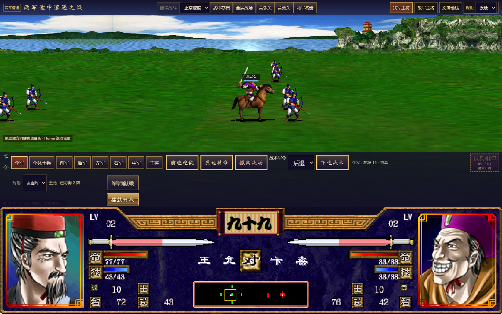
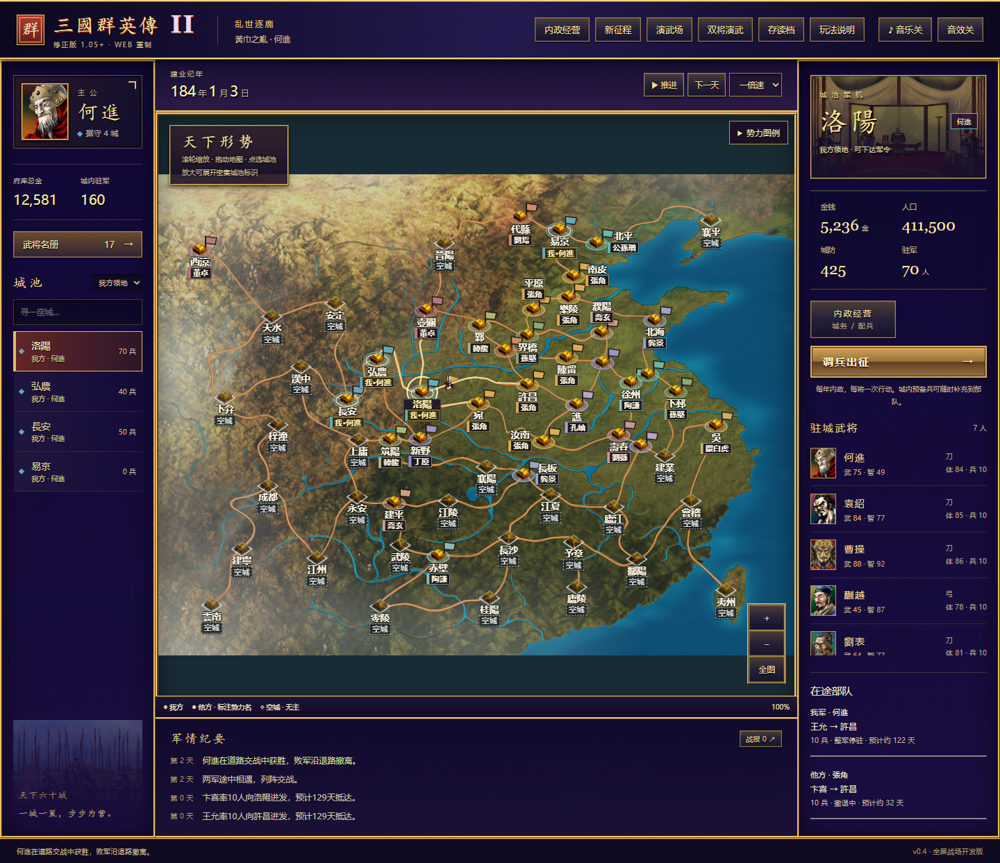

# 原版战略行军与道路遭遇战

本轮将道路移动、途中相遇和战后退军接入真实战役入口。新建原资料战役使用 `native-strategic-v1`；没有该标记的旧存档保留旧版按日行军。以下验证只覆盖列明的规则，不能代表整个游戏已经达到一比一。

## 已接入的行为

| 场景 | 当前行为 |
| --- | --- |
| 新局出征 | 保存军团原始定点坐标、路线节点、朝向、动画倒计时和冷却；按源更新逐步移动。 |
| 道路寻路 | 按原城池、邻路的遍历顺序求下一城，包括原图中的特殊道路。 |
| 途中相遇 | 以建议移动后的精灵包围盒检查全局军团，不限定同一条道路；进入实际战斗与轮将入口。 |
| 电脑互战 | 通过电脑战斗入口同步结算，幸存军团保留道路状态。 |
| 玩家道路战 | 标题为“两军途中遭遇之战”，身份标记为“两军遭遇”，没有城池归属或城防加成；地图暂停在当天发生相遇的源回调。 |
| 胜军收兵 | 原地整军，保留目的城；停驻计时到期后继续移动。 |
| 败军收兵 | 依原退路优先级选路，沿地图撤退；军资损失、随机数与冷却随存档保存。 |
| 战中存读档 | 道路双方、坐标、战斗状态与未完成的当日回调均可保存恢复。 |
| 行军界面 | 按当前速度显示“预计约”天数，停驻军计入已知整军时间，碰撞冷却不当成停驻；在途部队区分“行军中”“整军停驻”“撤退中”。目标选择关联说明，提示途中交战与停驻会改变行程。 |

常态速度为 1，败军速度为 3；停驻旗标下速度为 0。精灵每六次源更新才实际移动一次，路线门槛和冷却在其余更新仍会处理。地图一天使用十次源回调，不能沿用旧版“每天 60 道路单位”的速度解释新局。

## 原程序证据

取证脚本：`web-port-research/tools/native_strategic_movement_oracle.py`。固定向量：`packages/core/fixtures/native-strategic-movement.json`。

| 原入口 | 对应行为 | 向量数 |
| --- | --- | ---: |
| `0x406169 → 0x40E515 → 0x439A48 → 0x40E86F` | 建议坐标碰撞与每帧最多 16 对的队列 | 240 |
| `0x41152C` | 队列对象有效期、电脑先结算、最后玩家条目进入战场 | 160 |
| `0x439329` | 整数距离门槛、道路节点与城池转换 | 240 |
| `0x439141` | 战后旗标、冷却、军资及随机数顺序 | 160 |
| 原方向表与速度分支 | 定点朝向、普通/退军/停驻速度 | 214 |
| `0x401454` | 败军目的城优先级与随机抽签 | 240 |
| 精灵更新入口 | 六次更新的移动节拍与短整数计时 | 240 |
| 原最短路入口 | 城池/邻路松弛顺序与下一城 | 180 |
| **合计** | **局部原 x86 边界样本** | **1,674** |

碰撞门槛来自军团精灵 `SPACE=4,4,48,0`，双方 XY 范围合计 8 像素。每一对必须满足冷却条件，同一帧已入队的对象不能重复配对。电脑条目在玩家进入战斗之前完成结算。

退路顺序包括道路反端点、上一城、参考城的同归属邻城、空邻城、君主驻城、邻城洗牌、己方城链及其他可见城。邻城归属比较以参考端点当前归属为准；这与直接比较败军归属不同，会影响抽签和后续随机数。

## 实际入口验证

四组内核测试共 **1,690 项通过**：`native-strategic-movement.test.ts`、`campaign-native-movement.test.ts`、`campaign-road-battle.test.ts`、`campaign-road-dispatch.test.ts`。除原 x86 向量外，还检查真实 `march → advance → road battle → battle-finish → advance`，包括电脑互战、旧存档兼容与 JSON 恢复。

`tests/movement-replay.ts` 从实际转换内容创建原初始化新局，经真实指令让双方出征。测试仅将保存的军团坐标布置在原道路中段，并指定一位主将战术撤退的最后一步；碰撞、道路战创建和战后结算仍由实际游戏入口执行，不删除新局规则标记。

`tests/strategic-movement.spec.ts` 的四项 Chromium 用例覆盖：

- 新局行程估计与关联的辅助说明。
- 1440px、390px 下道路战标题、无城防、战中存档及当日回调恢复。
- 点击“收兵”后胜军停驻、败军仍在地图；推进一天后，胜军坐标保持、败军坐标继续改变。

这组验证发现并修复了一个实际缺陷：败军退回上一城时，目的城、下一城和上一城 ID 相同，旧判断会将其视作已在城内的归附军。现在只有路线节点相同的原地状态才直接归队，在路败军仍须经过原路线到达门槛。

原有三天到达战场的箭雨、武将技及存档回归，通过 `finishInitialPolicy(page,true)` 显式测试旧行军兼容。该夹具先正常创建原初始化新局，再经界面导出，仅删除存档中的行军与俘虏规则标记后导入；不会删除 `scene.initialization` 或改变原武将装备、现役/预备兵槽。新的道路回归始终保留全部原规则标记。

## 仍需验收的范围

- 特殊道路已进入原最短路，原界面的完整开放条件还需对照。
- 行程显示是路线估计；途中战斗、停驻、退军和道路节点门槛会改变实际抵达日。
- 这些局部样本与实际入口回归尚不能代替原客户端同输入的长时间整局重放，尤其是全局对象顺序、历史脚本与共享随机数的连续一致性。
- 道路战复用了现有战斗系统，其余尚未复刻的武将技、音画对象和系统事件仍受各自证据边界限制。

### Modern Web Guidance

- **`forms`**：我用 `aria-describedby` 把行程限制说明关联到原生目标选择，使读屏器能读出途中交战和停驻可能改变预计天数（“DO use aria-describedby to link inputs with help text or error messages.”）。
