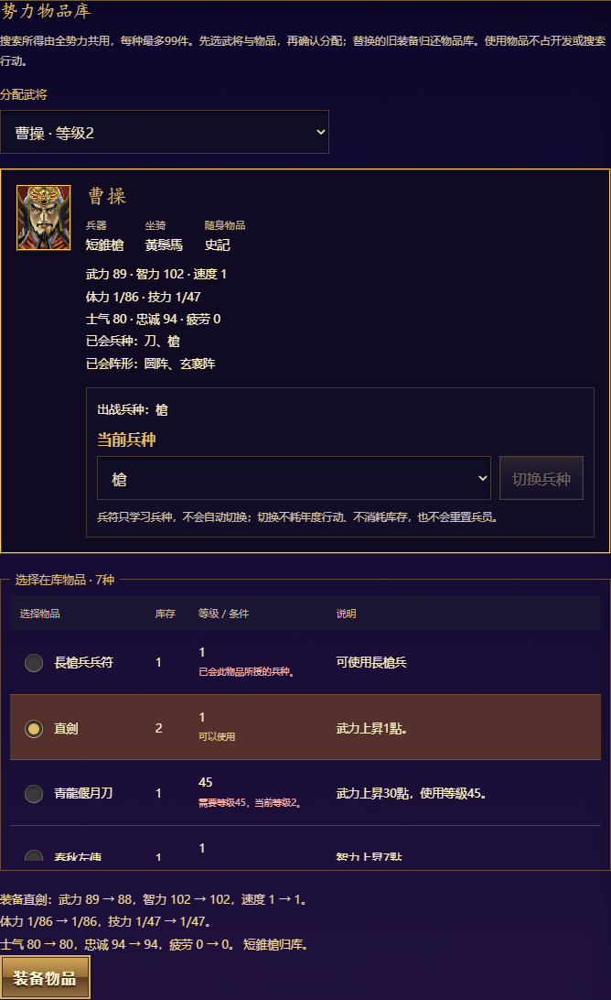

# 已学兵种、当前兵种与真实出征

本轮补入“内政经营 → 物品库 → 当前兵种”：武将使用兵符学会新兵种后，可以主动选择出战兵种。确认后，驻城武将、名册、行军配兵和战场共用这一选择；现役兵与预备兵各自使用对应的原版对象、攻击动作和命中时点，存档保留选择。

**当前兵种选择已在 Web 贯通，原版切换窗口、菜单事件和切换时的完整副作用仍未验收。** 本页不会把这项 Web 操作的接入等同于原客户端一比一完成。

## 原版证据与确定范围

目标 EXE 的 SHA-256 为 `1098558aaea96ae552753df786a8d3910df08fda11c8219dfa133ca001d8e419`。函数静态导出在 `web-port-research/evidence/ida/static-export/`；本轮沿用同一版本。

| 原函数 / 字段 | 已确认行为 | Web 对应 |
| --- | --- | --- |
| 武将 `+135` / `+139` | 前者为已会 FORCE 掩码，后者为当前 USEFORCE；不是同一字段 | `forceMask` / 可选 `currentUnit` |
| `0x42CB4D` / `0x42CBEE` | 分别载入 FORCE 与 USEFORCE；后者选择当前兵种并处理配置回退 | 保留内容定义中的初始兵种；运行选择单独存储 |
| `0x4088FA`、`0x424509` | 使用兵符增加已会掩码并扣库，不直接改当前 USEFORCE | 兵符不会自动切换当前部队 |
| `0x429F78` | 依 `+135` 显示13个兵种的已学/未学状态，依 `+139` 标出当前选择 | 区分“已会兵种”和“出战兵种” |
| `0x443498` / `0x442EFA` | 双方战场读取当前 `+139`，传给士兵对象映射与战斗属性流程 | `encounter()` 从运行武将定义创建战斗 |
| `0x406499` / `0x406501` | 现役/预备兵对象分别映射，敌方另加20 | 当前兵种的现役对象 `100+index`、预备对象 `140+index` |

这些证据能够支持状态拆分及战场读取方式。它们没有证明原版在何时允许玩家切换、是否需要清空或转换兵员，以及是否伴随其他资源变化；这些问题仍需恢复切换事件调用者并用客户端连续核对。

## 本轮 Web 行为

- 只允许选择本城己方在任武将，行军武将不可选择，战斗期间不可切换。可选内容来自武将已会 FORCE 掩码。
- 选择框只编辑待确认值；点击“切换兵种”才执行命令。界面另显示已经生效的“出战兵种”，防止把待确认选择误认为已生效。
- `policy-unit` 当前只写入当前兵种：不增减兵员、现役/预备兵槽、体技力、士气、库存、年度行动或随机状态；内政结束后也可操作。**这组外围限制和资源规则属于当前 Web 适配，尚不能声称与原切换事件等价。**
- `officerDefinition()` 同时返回当前兵种、对应士兵对象和现役/预备攻击时点；所有使用这一入口的界面和实战保持一致，内容文件不被修改。
- 存档新增可选字段 `currentUnit`。旧存档缺少该字段时继续使用原有定义；非法兵种或未学兵种的当前选择会被拒绝。
- 桌面并排显示选择与确认按钮；手机改为上下排列，保留原生选择框、48px操作高度、键盘焦点和状态反馈。

## 验证

新增17项核心集成检查：13个兵种分别从内政切换、真实行军到敌城并创建战斗，核对当前兵种、现役/预备士兵对象、各自原攻击动作与时点、战中存档恢复；其余覆盖兵符只学习不切换、未学/非法兵种、敌将/行军/战中拒绝、内政结束后操作及旧存档。

真实浏览器在1440和390宽度验证：兵符学习后仍保持原兵种、选择后未确认仍显示原出战兵种、确认切换、换人后回到同一武将、导出/导入恢复，以及内政结束后继续操作。检查选择框和按钮没有超出对话框，并人工查看生成截图。

本轮全量验证：44个核心测试文件、14,718项测试；54个Chromium场景；6项Python测试、类型检查与生产构建通过。原物品384组x86差分样本仍保留，本轮没有新增“原切换事件差分样本”，不能将Web集成测试数量当作新的原码等价证据。

## 继续验收的边界

1. 恢复原兵种切换窗口的事件入口、可选对象与开放阶段，核对兵员转换、资源消耗和确认/取消行为。
2. 建立同一原客户端存档下“使用兵符 → 切换 → 出征 → 战斗 → 读档”的连续基线。
3. 对齐原13兵种窗口的640×480布局、字库、图标和输入方式；当前响应式操作属于Web界面。

物品、阵书及特殊坐骑的其他差距继续登记在 [物品对照](NATIVE-PLAYER-ITEMS-PARITY-2026-11-19.md) 和 [完整漏项总账](FULL-PARITY-BACKLOG.md)。
