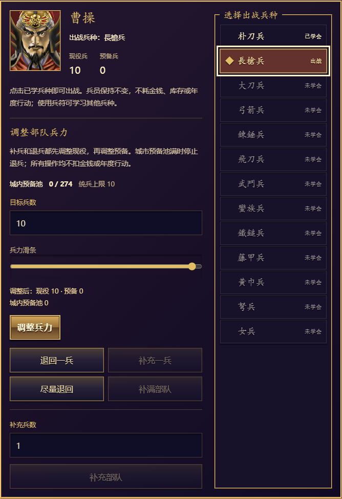

# 原版兵种选择：事件、配兵与真实出征

兵符只增加已会兵种，不会自动改变出战部队。Web版现可在 **内政经营 → 部队征兵** 查看全部13个兵种，点击已学兵种立即切换；物品库保留“选择后确认”的便捷入口。选择贯通驻城状态、名册、行军、现役/预备战斗对象和存档。

**原选择事件已取证：检查已会掩码，只写当前兵种，不改兵员或资源，也不消耗随机数。** 原窗口逐像素表现、外围菜单开放时机及客户端连续战役仍未验收，不能据此宣称全游戏一比一完成。



截图使用“曹操只学刀/枪、城中预备池为0”的测试存档，便于确认已学/未学与当前出战状态；不是普通开局全部数值。手机保留相同名单与规则，改为两列48px以上的操作按钮。

## 找到的原窗口事件

目标EXE SHA-256：`1098558aaea96ae552753df786a8d3910df08fda11c8219dfa133ca001d8e419`。旧IDA导出遗漏了真正的选择函数；本次直接读取哈希校验后的PE机器码，恢复窗口回调与静态子窗口表，避免把详情展示或调试快捷键误当玩家操作。

| 原入口 / 字段 | 实际行为 | Web对应与范围 |
| --- | --- | --- |
| 武将 `+135` / `+139` | 已会FORCE掩码 / 当前USEFORCE，两个独立字段 | `forceMask` / 可选 `currentUnit` |
| `0x4088FA`、`0x424509` | 兵符增加已会掩码并扣库存，不改当前兵种 | 学会后由玩家另行选择 |
| **`0x41719C`，事件4** | 从子窗口 `+32` 读兵种序号；检查 `+135 & (1 << index)`；通过后只写 `+139`，调用 `ACCEPT`、音量255 | `policy-unit`已有同一资格/写入规则；配兵名单点击立即执行；原确认音尚未接入 |
| `0x41719C`，事件512 → `0x41D160` → `0x41CF77` | 检查输入位 `0x10000`；鼠标严格位于窗口内部，转发事件4；边界不命中 | 原坐标路径保留机器码样本；Web采用浏览器原生按钮输入，不声称像素命中范围等价 |
| `0x487AF8 + index × 56` | 13个静态子窗口，回调均为 `0x41719C`，序号0～12，父窗口 `0x487DD0` | 依原顺序、原名称显示全部13种，未学项禁用，当前项有菱形及“出战”文字 |
| `0x41A923`，事件4 | 打开兵种窗口，随后调用 `0x41A6FB` | 证明兵种选择属于配兵路径；仍需补齐外围待完成补兵和菜单生命周期 |
| `0x41A6FB` | 仅当全局 `0x4A6424 == 1` 时，从当前城市预备池先补现役、再补预备，并清除此待完成标记 | **这是先前补兵操作的收尾，不是选择兵种清兵/转换兵员的证据。** Web已接双向目标调兵和立即补满的最终状态；不保存原按住/逐更新临时状态，见[双向配兵](TROOP-TRANSFER-2026-11-19.md) |
| `0x429F78` | 依已会掩码显示13种状态，依当前兵种标记选择 | 这是详情展示；真正的点击函数是 `0x41719C` |
| `0x443498` / `0x442EFA` | 战斗初始化读取当前兵种 | `encounter()`经运行武将定义创建部队 |
| `0x406499` / `0x406501` | 现役/预备对象分别映射，敌方加20 | 现役 `100+index`、预备 `140+index`，各自原攻击动作与时点 |

[原函数反汇编证据](evidence/native-troop-selection.json)保留完整选择函数及打开窗口的入口。原窗口中已学项点击立即生效，没有额外“确定后写入”分支；再次点击当前项仍写入同一值并发出确认音，未学项不写入也不发声。物品库的显式确认是Web便捷操作，配兵入口遵循原点击即生效行为。

## 可重复的机器码样本

生成器：[native_troop_selection_oracle.py](../../web-port-research/tools/native_troop_selection_oracle.py)；样本：[native-troop-selection.json](../packages/core/fixtures/native-troop-selection.json)。

- **104组直接事件**：13种兵 × 8组已会掩码/当前兵种，含空掩码、全学、仅学当前、排除目标、交替位和固定种子随机状态；覆盖重复点击。
- **104组原鼠标路径**：13种兵 × 内部、未学、无按键、其他输入位、左/右/上/下边界，使用原父窗口(534,147)、106×333及子窗口尺寸，完整执行裁剪、命中检测与回调；右边界640在未裁剪子窗口内，仍须拒绝。
- 唯一替换项为音频播放回调 `0x4697B0`，保留并核对 `ACCEPT/255` 参数；不替换资格检查、写入、命中检测或RNG。
- 原内存包含不同非零字节，记录**全部非栈写入**：合法选择恰好写4字节当前兵种；其余情况零写入。全部样本原RNG前后相同。
- 104组直接事件与真实Web命令差分，核对接受/拒绝、当前兵种、全部武将、城池、库存、年度行动和随机状态。104组原鼠标样本由Python执行器断言，不能把它们称为Web坐标差分。

在根目录使用已安装 `requirements-ai.txt` 依赖的Python运行：

```powershell
.\web-port-research\.venv-ai\Scripts\python.exe web-port-research/tools/native_troop_selection_oracle.py
```

原EXE不随仓库分发；没有本地EXE时可运行已提交样本对应的Web测试，不能重新生成原码证据。

## Web规则与验证

只能操作本城己方在任武将，行军武将不可选择，战斗期间不可切换。当前选择不改现役/预备兵槽、体技力、士气、资源、年度行动或RNG；原叶事件的无副作用行为已取证，Web的城池/战斗/阶段外围限制仍需客户端连续核对。

保留此前13兵种真实出征检查：切换后实际行军到敌城，核对双方部队使用的现役/预备对象、原攻击动作与命中时点、战中存档恢复。旧存档无 `currentUnit` 时沿用内容默认兵种；非法或未学当前兵种会被拒绝。

1440与390宽浏览器检查覆盖：13项完整显示、未学禁用、当前标记、Enter/Space切换、重复点击、零预备池、已用年度行动、换将、导出/导入，以及内政结束后继续选择。切换按钮显式 `type="button"`，不会提交外层补兵表单；原生焦点保留，反馈由状态区域播报。生成的桌面/手机截图均已人工查看。

本轮全量验证：**44个核心测试文件、14,822项测试；56个Chromium场景；6项Python测试；类型检查与生产构建通过。** 命令记录位于 `docs/evidence/commands/native-troop-selection-*-2026-11-19.log`。首轮核心测试与浏览器/构建并发时，旧搜索集成用例超过默认5秒；单文件788项复跑通过，随后核心全量限制3个并发执行，14,822项通过。初次失败与复跑日志均保留，未提高超时或跳过用例。测试数量不是全游戏还原比例。

双向调兵的后续实现、328组原机器码样本和最新全量验证见[配兵与退兵记录](TROOP-TRANSFER-2026-11-19.md)。

## 仍需完成

1. 原配兵菜单开放阶段、窗口关闭/取消及待完成补兵的全过程，原确认音与640×480布局、字库、图标。
2. 同一原客户端存档下“使用兵符 → 打开配兵 → 切换 → 出征 → 战斗 → 读档”的连续基线。局部机器码证明不能代替原客户端整局验证。
3. 当前名单、48px按钮、手机两列和物品库确认方式是Web适配，尚非原窗口逐像素复刻。

其他漏项继续登记在[物品对照](NATIVE-PLAYER-ITEMS-PARITY-2026-11-19.md)和[完整漏项总账](FULL-PARITY-BACKLOG.md)。
