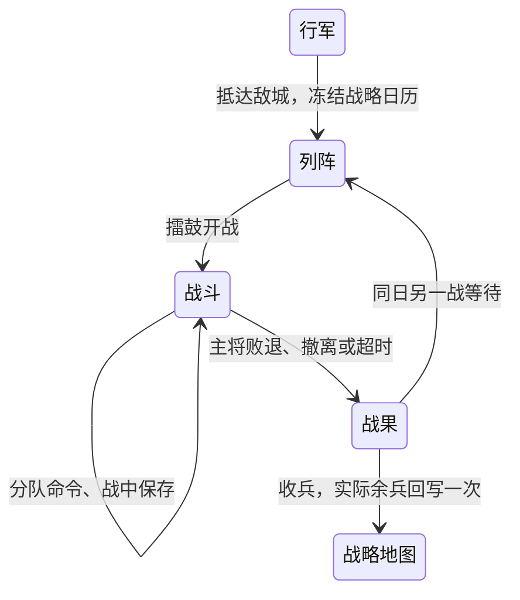

# v0.2：滚轮、原版界面材质与实时战场

用户指出滚轮不可用、界面缺少游戏氛围、缺少实时战场，要求继续一比一复刻。本轮完成这些方面的实际功能改进，未把暂定规则标记为忠实还原。

## 证据与实现

旧地图只有 pointer 拖动与缩放按钮，没有 wheel 事件。真实滚轮测试中画布前后完全相同，测试失败。修复后画布缩放，鼠标原位置仍命中長安，页面不滚动。使用标准 WheelEvent，没有采用易变的 scroll-axis-lock。

视觉使用原包 TEXTURE.TEX 蓝紫石纹、TITLEBG 列阵图、宫殿与地图城池素材。战场导出13种步兵蓝红两套、600/800代表主将身体、700剑、900坐骑，共30对象/1,036源帧。源SHP字段6/7作为绘图锚点，合成身体、武器与马，已查看结果。

保留帧时长与OM_ATTACK不等于已还原原时钟。画面暂按60Hz源动画时间播放，模拟20Hz，命中使用临时第7步、攻击周期20步；尚未完成源事件驱动的严格同步。没有实现技能解释器。主将仍是代表模型，没有按所有武将的真实身体、装备和马匹选择。

## 战役接入

Session.battle保存完整可序列化状态；战斗期间拒绝战略命令。battle-finish仅在战果确定后执行，拒绝重复结算。同日其他军团不被重复推进时间。存活士兵加预备兵得到实际余兵，没有以绘图数量乘系数计算战果。

旧web-strategy-preview-v1存档显式迁移到web-tactical-preview-v2，保留资源、人物、军团和旧历史，新battle字段为空。中途存档继续执行能得到相同战果；读入后暂停，不自动替玩家下令。

## 验证

25项核心测试通过；8项Chromium完整流程通过。包括实时演武、伤亡和撤退；敌城交战中暂停保存、刷新读档及余兵归城；战场手机操作；滚轮锚定、内政、五剧本、跨页保存和导入导出。1440×1000及390×844截图已查看。类型检查与生产构建通过。

这不代表跨浏览器、原版行为、长期稳定性或性能验收通过。此轮没有执行原Windows游戏作运行对照。

## 下一步：一比一校准

1. 建立原程序可复现战斗录像和状态对照，核对计时、移动、普通攻击、伤害、逃跑与武将出场顺序。
2. 让已导出的源动画事件直接驱动模拟命中，恢复兵种距离、相克、骑乘和特殊行为。
3. 将主将代表模型替换为人物真实身体/装备/坐骑映射；实现每将独立兵力、体力、技力与多轮对战。
4. 对治疗、单体、范围三类技能建立脚本与运行样本，再扩展110技能及军师技。
5. 增加敌方战略AI、俘虏、归属、内政/成长/物品规则，替换暂定规则并升级存档迁移。

## Modern Web Guidance

搜索wheel canvas zoom和pointer wheel events后，2d-panning要求易变特性opt-in；未启用，也未使用scroll-axis-lock。读取并应用accessibility：原生军令按钮、可见焦点、战场文字状态和后台暂停；缩放output关闭实时播报，战场每帧状态不进入live region。依据原文“Prefer HTML elements and attributes to ARIA”。进入战场聚焦战斗标题；存读档继续使用原生dialog。
