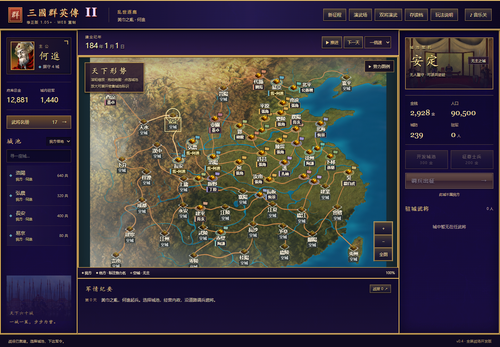

# 三国群英传2 Web重制：解析与方案

基于用户提供的《三国群英传2 修正版 1.05+》游戏包，初始分析日期2026-11-16。**本目录保留研究与设计成果。当前可游玩的 Web 开发版、实机截图及复刻进度见[仓库首页](../README.md)，运行方法见 [sango2-web](../sango2-web/README.md)。** 已接入战略层和实时战场，整体尚未达到一比一验收标准；以下为初始研究记录。

推荐技术栈：**TypeScript + PixiJS 8（WebGL）+ React + Vite + IndexedDB**。以原始资源转换和独立模拟内核重建玩法，中文、桌面浏览器、单机优先。

## 阅读顺序

1. [总体方案](docs/00-Web重制总体方案.md)：目标、确定技术栈、系统架构、数据模型、游戏实现策略、存档与发布。
2. [资源与数据全量解析](docs/01-资源与数据全量解析.md)：全部资源统计、解码结果、剧本数据、动画引用、地图与剩余未知。
3. [玩法特征与版本规则](docs/02-玩法特征与版本规则.md)：内政/战略/战斗/成长、版本修复、默认与可选内容、规则证据。
4. [技术选型与官方依据](docs/03-技术选型与官方依据.md)：路线比较、浏览器约束、性能策略、18项官方来源。
5. [脚本与运行时逻辑边界](docs/04-脚本与运行时逻辑边界.md)：EXE依赖、SO结构、技能入口、宿主调用和逆向研究关卡。
6. [实施里程碑与验收](docs/05-实施里程碑与验收.md)：阶段产物、25项功能验收、性能与风险、第一批开发任务。

## 本次已经做了什么

- 完整解压并登记1,829个文件，逐项哈希；PAK内11,110成员全量登记。
- 10,969个基础SHP与1,780个可选SHP全部解码并逐字节往返验证成功。
- 全部10个INI、19个TGA（包含7个TEX）、4个PCX（MSK）、99个PCM WAV已读取/检查。
- 5剧本各401人物记录（400武将+盗贼）、60城、116路；110武将技、67军师技等级记录、77物品、12地形实例。
- 621物件段、620唯一ID、4,026动作字段；35,269次图像引用可解析。测试对象99的8个缺图引用单独登记。
- 两个当前SO的502条函数记录、193个数字入口可定位；110/110技能入口、15/15动画回调能映射。
- 全文读取17份TXT、提取12个宝典表；核对关键数值、道路与可选补丁差分。
- 生成真实地图道路预览及多类资源图，制定完整Web重制方案。

**研究阶段尚未完成**：SO指令和宿主调用的完整语义、原程序算法/AI/运行行为还原、完整Web实施、原SAV兼容、战斗性能实测。静态分析未运行游戏或修改器，不能代替完整玩法对照。战略原型的实施与测试状态单独记录在 [开发记录](../sango2-web/docs/DEVELOPMENT.md)。

## 本地可复查产物

下列 `data/`、`previews/` 和 `evidence/` 均为本地生成的分析产物，由 Git 忽略，公开仓库不包含这些文件。可提交的规则对照样本在 `../sango2-web/packages/core/fixtures/`，源码工具在本目录 `tools/`。

| 目录/文件 | 用途 |
|---|---|
| [data/summary.json](data/summary.json) | 全量计数、哈希、解码结果 |
| [data/pak-manifest.csv](data/pak-manifest.csv) | 每个PAK成员路径、范围、格式、哈希、解码状态 |
| [data/package-manifest.csv](data/package-manifest.csv) | 游戏包全部解压文件 |
| [data/game-catalog.json](data/game-catalog.json) | 原始剧本、人物、城池、道路、技能、物品、地形 |
| [data/config-records.json](data/config-records.json) | 不丢重复段/键的原始配置与行号 |
| [data/content-checks.json](data/content-checks.json) | 关系闭合、动画引用与可选SHP检查 |
| [data/content-coverage.csv](data/content-coverage.csv) | 后续逐项实施与验收覆盖表，当前均未实施 |
| [previews/world-map-routes.png](previews/world-map-routes.png) | 实际地图、城市与道路折线的叠加图 |
| [evidence/rules/](evidence/rules/) | 全部说明、表格、版本差分与交叉校验 |
| [evidence/binary/](evidence/binary/) | PE/SO解析结果与可重跑脚本 |
| [evidence/web-docs/](evidence/web-docs/) | 官方网页来源、获取状态与缓存证据 |
| [tools/](tools/) | 本轮编写的全量静态检查与预览脚本 |

原始游戏完整解压在相邻 `game-original-105plus/`，上轮提取的分析副本在 `game-package-inspection/`；英文补丁仓库保持独立。研究产物含用户游戏包派生数据，`.gitignore`把本地证据、数据、预览与分析依赖排除在默认Git提交之外；文档和工具可独立管理。
