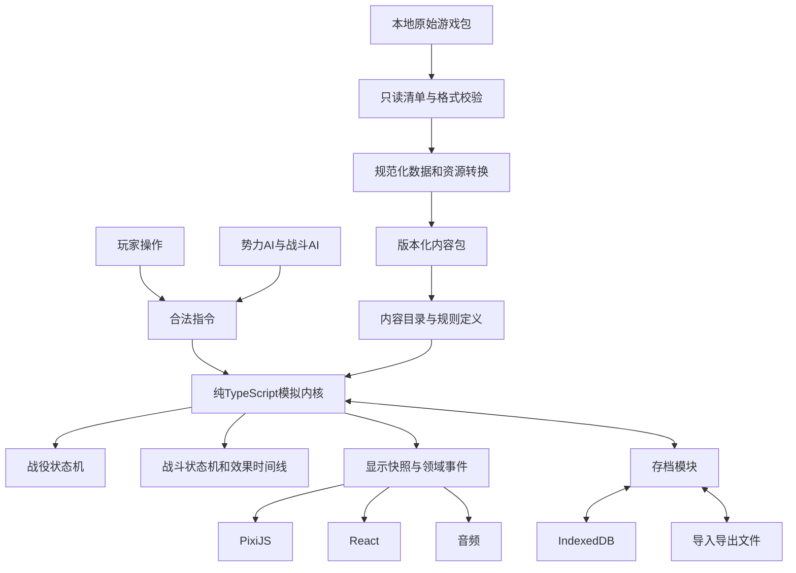

# 《三国群英传2 修正版 1.05+》Web 重制总体方案

日期：2026-11-16。状态：**分析与设计完成，Web 游戏尚未实施**。基准输入为本次提供的游戏包及其2021-09-16重打包说明，精确 EXE/PAK 指纹见资源报告。

## 1. 项目决策

采用 **原资源转换 + 浏览器原生2D表现 + 游戏规则重新实现**。技术栈确定为：

| 层次 | 确定选型 | 用途 |
|---|---|---|
| 游戏语言 | TypeScript，严格类型 | 战役、战斗、技能、AI、指令与存档模型 |
| 图形 | PixiJS 8.x，生产默认 WebGL | 世界地图、兵将动画、技能效果、场景与相机 |
| 信息界面 | React + CSS | 开始/选剧本、武将/城市列表、内政操作、设置、存档 |
| 工程 | Vite + pnpm workspace | 浏览器构建、模块组织、开发与发布；开工时锁定具体依赖与 Node LTS |
| 内容工具 | Python 3.12 + Pillow；必要时 NumPy | PAK/SHP/配置解析、校验、图集与内容包构建 |
| 持久化 | IndexedDB + 文件导入导出 | 本地多槽位、自动存档、备份与版本迁移 |
| 音频 | Web Audio + HTMLAudioElement | 短音效与长背景音乐分别管理 |
| 自动验证 | Vitest + Playwright | 无界面规则测试、确定性回放、浏览器完整流程 |
| 部署 | 静态 HTTPS 网站 | 单机游戏无需游戏服务器；完整离线在内容闭环后通过 Service Worker 加入 |

首版产品默认：**中文、桌面浏览器、单机、原版2D美术风格、以当前1.05+包的默认规则为目标**。桌面 Chrome/Edge、Firefox、Safari 列入兼容验证；具体版本在每次发布报告记录。触屏操作属于后续独立交互适配。

目标是完整可玩的战役重制，不止素材浏览器。完整交付范围是5个剧本、400名常规武将及盗贼特殊模板、60城与116条道路、13兵种、9种常规阵形及军师技特殊布阵、110武将技、67条军师技等级记录、77物品、12地形实例，以及内政、AI、战斗、俘虏、胜负和存读档闭环。数量来自静态内容，真实效果逐项验收。

本次没有原游戏完整源码，现有英文补丁仓库只包含资源编辑、运行时补丁与安装工具。不能把 Win32 EXE 直接编译为 WebAssembly。选择 PixiJS 是因为本项目需要自定义模拟与复杂信息界面；Phaser、Godot、WASM、串流等替代路线的具体比较及官方依据见 [技术选型报告](03-技术选型与官方依据.md)。

## 2. 已证实的可行性与尚未证实的部分

### 已证实

1. 全部11,110个PAK成员可枚举；10,969个SHP和1,780个可选SHP均完成字节一致的解码/重编码检查。
2. 10个INI全部可读取，包含剧本、物品、地形、对白、技能及621段物件定义。显式人物/城市等关系完成20,663次检查，未发现未解析项。
3. 地图1280×960、城池坐标与道路折线已实际绘制；19个TGA（含7个TEX）与4个PCX（MSK）均能完整加载。
4. 两个在用SO保留502条函数记录和193个非零数字入口；110个武将技SCRIPT引用与15次动画回调均能映射到入口。
5. 包内文档、12个宝典表和可选配置差分已读取，能把基础规则与附加补丁区分开。

### 仍需在实施前段解除的不确定性

- SO字节码语义、宿主调用与旧内存读写；67条军师技主要不能靠MAGIC脚本入口迁移。
- 普攻/索敌/移动/碰撞/集气/伤害、AI、内政收益、成长、招降、统一和灭亡条件等运行规则。
- 动画计时单位、攻击命中事件位置、各部件锚点、混合光效、MSK索引含义。
- 原版SAV完整结构。当前SAVES为空，首版使用Web自己的存档，不承诺原存档可直接读取。
- 修正版说明里的功能是否确已在此EXE启用；本次只有声明或局部静态证据，尚未录制原游戏流程。

这决定项目的主要工作量在**规则恢复、模拟、内容验证**。素材迁移已具备较高确定性；“完全忠实”程度要由行为对照确认，不能以图片解码成功代替。

## 3. 版本与产品规则

### 版本基线

定义新项目规则集 ID：`sg2-105plus-repack-20210916`。它是Web项目的命名，不是原游戏已有标识。内容清单同时固定EXE与PAK哈希；可选补丁作为明确的覆盖包登记。

- 默认人物、技能MP、物品以PAK为准。
- 重打包说明优先于早期“附加内容默认未开启”的声明；默认开关仍记录证据级别。
- 恢复技力、劝降、逼近/偷袭位置、血缘/成年等均按修正版验证；Steam翻译项目的公式只作为线索。
- 原始数据中的错字/繁简差异可做显示层统一；稳定ID、原字段与来源不随显示文案变化。
- 400名常规武将与盗贼模板分开建模；不依赖中文姓名匹配系统势力。
- 不确定规则进入 `unverified` 清单；如果阶段版本采用近似规则，标为 `approximation`，并为该规则集独立编号，不宣称与原版等价。

### 美术与界面

游戏内地图、人物、兵种、物品、战场和技能尽量复用已验证原素材。保留4:3战斗视口作为第一套布局，现代窗口通过等比缩放/留边容纳。大地图使用独立相机，不把1280×960世界纹理尺寸等同显示窗口。

内政和人物管理采用清晰可读的DOM表格/面板，可排序、筛选、键盘操作；场景内紧凑状态栏沿用原视觉语言。第一版避免把烘焙中文字、React文案和Pixi文字重叠绘制。右键/悬停/H键的效果列入桌面交互对照，触屏以后提供显式按钮。

## 4. 系统架构



建议工程目录（尚未创建实现）：

```text
sango2-web/
  apps/game/                 # React应用壳、输入、路由、浏览器能力
  packages/core/             # 战役、战斗、AI、随机数、时钟、规则
  packages/content/          # 内容Schema、稳定ID、版本清单、引用检查
  packages/render-pixi/      # 场景、相机、图集、动画表现
  packages/persistence/      # 存档事务、迁移、导入导出
  packages/audio/            # 播放策略、音量与音效调度
  tools/content-pipeline/    # Python离线资源转换
  tests/fixtures/            # 最小场景、指令回放、已验证规则样例
  docs/rules/                # 每条公式/系统调用的证据与验证状态
```

### 模块接口与约束

| 模块 | 少量外部接口 | 实现内部负责 |
|---|---|---|
| 内容目录 | `loadContent(manifest)`、`getDefinition(id)` | 名称映射、引用、资源覆盖、版本检查与缓存 |
| 模拟内核 | `createSession(options)`、`dispatch(command)`、`step(ticks)`、`snapshot()` | 合法性、事件顺序、战役/战斗、AI、随机性 |
| 渲染 | `mount(host)`、`present(snapshot, events)`、`dispose()` | Pixi资源生命周期、动画、镜头、批处理 |
| 存档 | `save/load/export/import` | 事务、备份、迁移、损坏和内容不匹配处理 |
| 音频 | `unlock/playEvent/setMix/pause` | 用户激活、播放拒绝、音效并发、长音乐流式播放 |

core不引用DOM、Pixi、React、IndexedDB或墙上时钟。AI和玩家走同一指令合法性检查，渲染器只能消费状态，不能直接扣血或修改城市归属。存储适配器只在确有文件导入与IndexedDB等差异处引入，不预造多人网络同步框架。

React仅接收交互后或低频摘要更新，不给每个士兵创建组件。Pixi插值显示可以丢帧，逻辑中的攻击事件仍按固定tick结算。动画触发命中语义属于内核时间线，不能由某个浏览器render回调决定是否命中。

## 5. 数据模型与迁移

### 内容定义与运行状态分离

| 内容定义 | 关键字段 | 对应运行状态 |
|---|---|---|
| ScenarioDefinition | 剧本ID、原年号、起始势力/城市/人物覆盖 | 当前年月日、阶段、玩家势力、事件队列 |
| GeneralDefinition | 稳定ID、原Sequence、源名、头像、基础属性、血缘、技能习得表 | 所属/所在、等级经验、HP/MP、忠诚、疲劳、装备、兵力、可用状态 |
| FactionDefinition | 稳定ID、君主模板、旗帜、选择标记 | 当前君主、城市、军团、灭亡/流浪状态、AI计划 |
| CityDefinition / RoadDefinition | 固定坐标、路径折点、原Length、地形引用 | 城主、太守、军师、人口、金钱、防御、驻军、在途军团 |
| ItemDefinition | 原ID、类型、要求、效果字段、唯一性线索 | 归属、装备槽、已发现/已消耗状态 |
| SkillDefinition / StrategyDefinition | 原ID、MP、目标、明确入口、等级字段、证据状态 | CD/集气/封技、效果实例、持续时长、施放阶段 |
| ObjectDefinition / Animation | Sequence、Process、flags、空间、动作token、资源ID | 位置方向、当前动作、帧游标、碰撞类别、所属阵营 |
| BattleSession | 参战军团引用、地图实例、随机状态、规则版本 | 出阵队列、单位、投射物、计时、结算标志 |

不把 `GAME_CATALOG` 的原始字符串直接当最终业务类型。需要严格区分空值、`未`、数字、位集合、命令宏、名称引用和资源路径；未知枚举在导入阶段报告，不默认转零。

### 导入流程

1. 校验PAK指纹与成员范围，建立大小写不敏感的资源索引；保留原路径。
2. 按格式解码；INI严格CP950，输出UTF-8，重复段/键保留顺序。
3. 生成稳定ID与源位置。普通武将可在确认唯一性后基于原Sequence映射；盗贼使用特殊ID。缺失/重复ID不得靠展示名静默覆盖。
4. 验证全部引用与约束。重复17021内容一致可去重；测试对象99未找到图片须有明确“开发测试记录”标记，证明不可达后才能排除。
5. 把动作token转为中间表示（frame、timing、sound、event、callback），未确认单位/操作码保留原值和待验证标记。
6. 输出不含原路径依赖的内容包：`manifest.json`、定义数据、图集、音频索引和规则版本。清单记录源哈希、转换器版本、产物哈希和包依赖。
7. 对人物、物品、技能、剧本逐项建立覆盖行：已解析、已实现、已对照、未验证原因。现有研究表可直接作为起点。

图集按主菜单/世界地图/默认头像/战场/兵种/武将部件/技能簇拆分。先保存RGBA PNG无损基准，再实测裁边/去重/打包；改变边界时同步调整锚点。默认图集边长以2048为候选，实际根据MAX_TEXTURE_SIZE、批次和显存决定，不能把候选写成所有设备保证。

4份MSK需要保留原调色板索引；不能先转成漂亮彩色PNG后丢失索引。12套地形即使名称重复仍是12个独立场景ID。可选头像包414张不能推导出414名武将。

## 6. 游戏逻辑实施策略

### 战役

建议显式状态：`选剧本 → 选势力 → 初始化 → 内政/世界地图 → 战前准备 → 战斗 → 结算 → 世界地图 → 终局`。具体内政周期、自动进入时机和战斗期间世界是否冻结，以基准运行结果定；不会仅凭这张概念图强行改变原流程。

城市/道路是图结构。以ROAD.POINT负责显示，以已验证的移动成本负责通行时间。先保留原LENGTH并隔离特殊值；普通几何长度和规则时间不得混用。军团移动、遭遇、入城、满员分流和战后逃跑使用明确事件，避免一帧重复触发战斗或结算。

### 战斗

内核先以30Hz固定逻辑步长、60FPS插值显示作为实验配置，校准后固定；原程序实际tick率未确认。随机数必须带种子且可保存，实体遍历顺序稳定。切后台默认自动暂停，恢复后主动继续；不把后台经过时间一次性补算成战斗结果。

战斗至少拆为：初始化与布阵、索敌/移动、近战攻击、远程弹道、碰撞与目标过滤、主将/士兵属性、技能/军师技、士气疲劳、撤退与结束、经验/俘虏结果。画面排序与攻击判定分开；单位阵营、敌我伤害、目标类型和穿透等规则必须显式。

首先验证双方各200士兵加武将的候选压力场景，再根据原程序实测最大兵力补齐；这个数字是实验负载，不是本次已证实的修正版上限。对象池、空间网格、TypedArray或Worker只在真实热点出现后引入。普通Worker不要求共享内存；首版避免将跨源隔离设为运行前提。

### 技能与脚本

**确定主线为TypeScript效果逻辑 + 数据化时间线。** SO用于恢复原效果依据，先不把完整旧VM作为所有开发的前置依赖。

对命疗、落月弓、地泉冲、火箭、伏兵、旋灯、拒陆马等样本建立：目标规则、施放条件、消耗时点、生成物件、作用范围、每次命中、结束与中断。验证完基本操作再复用到完整110技能，不能只按名称分组后假定同类招式效果一致。

安排一个有界的脚本研究阶段（约1—2工程周的计划预算，按实测调整）：恢复少量指令、分支、调用与宿主接口，并让代表技能生成可解释效果序列。如果原VM恢复能显著降低技能成本，则增加“离线SO→效果IR转换器”；否则继续明确语义重写，逐项记录原入口与实现的对应。旧内存访问调用必须映射为受控游戏状态访问，不能简单忽略或返回零。

67条军师技单独建表，含31个基础名称和等级差异；战前冲突、智力比较、免退坐骑、封技概率和恢复计时分别验证。宝典克制矩阵目前不能当作伤害百分比，默认不直接写进伤害公式。

### AI

分为战略AI（城市调度、内政、招募、目标选择）、战前AI（出阵、军师计、兵种阵形）和战斗AI（主将/士兵命令、技能时机、撤退）。每层提交合法指令并保存决定所用随机状态；初期实现可解释的规则优先级，逐场与原行为对照。

如果无法证明原AI策略，阶段版本标为“Web重制AI”，不标“原版AI完全复刻”。AI智能程度和规则合法性分别验收；不能用加资源或跳过合法性检查掩盖策略缺陷。

## 7. 存档、加载与部署

Web存档头建议包括 `schemaVersion / rulesetId / contentHash / scenarioId / revision / tick / rngState`；正文保存权威状态、事件队列、临时效果、在途军团和必要战斗状态。显示对象、DOM、纹理和音频实例不入存档。

IndexedDB事务成功后再提示保存完成，保留上一份有效快照；支持多个槽位、自动备份、导出/导入文件。加载先检查版本与内容依赖，再做显式迁移。多标签页用revision冲突检测避免旧快照覆盖新进度。浏览器清理站点数据会影响本地进度，因此导出入口是必备功能，持久化申请只是补充。

先完成主菜单与指定剧本的按需加载，再实现完整离线。音效首次用户交互后解锁；播放失败允许静音继续。17首MP3不在启动时全部解码。资源包缓存可清理，存档应独立保存；更新用内容哈希和依赖清单原子切换，进行中的战役固定规则版本。

开发与个人验收直接使用本地转换产物；公开部署前确定美术、音乐和文本的使用方式。原补丁工具的MIT许可不覆盖游戏素材。若不随站点分发原素材，后续可做本地内容包导入，优先接收转换后的包，而不是要求浏览器首次就解压完整7z；这是一项明确的发布方式决策，不影响当前本地研究。

## 8. 最小完整切片与完成定义

第一可玩里程碑固定为：**一个剧本、一个已验证可选势力、至少两个相邻城市、一次内政操作、一次出征、一场含基础技能的完整战斗、一次俘虏/归属结算、一次存档及恢复。** 使用真实美术与数据，验证路线和战斗规则，不把它称为完整移植。

完整V1扩展到全部剧本、人物、单位、技能、军师技、物品与场景，包含完整战役胜败和AI。每项都需要规则、视觉、交互和持久化验证。若仍有未知核心规则，它们会作为未完成项保留，而不是靠菜单中能点击就判定完成。

实施拆解、依赖关系、验收门槛和风险见 [实施里程碑与验收](05-实施里程碑与验收.md)。推荐第一开发任务是**内容工具标准化 + 原程序基准采集 + 真素材战斗验证**，其结果会校准后续预算。
