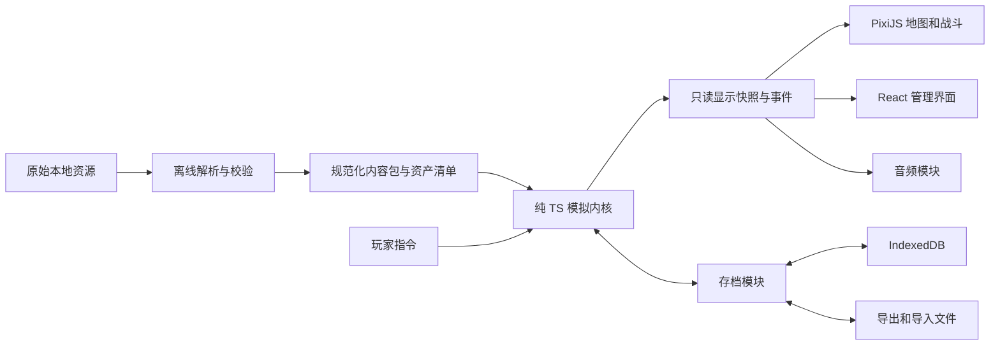

# Web 重制技术选型与官方依据

研究日期：2026-11-16。范围：将用户提供的《三国群英传 II》1.05+ 修正版做成中文、桌面浏览器优先的单机 Web 游戏。本文是实施方案，不代表 Web 版已经开发或性能已经达标。

本文把“官方能力事实”与“本项目建议”分开。游戏内容数量、技能效果和修正版差异以本次本地资源解析报告为准；引擎文档不能证明游戏原逻辑。

## 1. 推荐决策

采用 **TypeScript + PixiJS 8.x（WebGL 渲染）+ React + Vite**。以独立、可在 Node.js 中运行的 TypeScript 模拟内核实现战略与战斗，IndexedDB 保存进度，资源离线转换成清单、结构化数据、纹理图集和音频。首版不需要运行时业务服务器。

这是一项**基于原资源和已验证规则的重写工程**。当前持有的是 Win32 可执行文件、资源包、修订说明及英文补丁工具源码，没有原游戏完整源码。Emscripten 编译的是 C/C++ 等 LLVM 支持的源代码，不会把现成的 Windows EXE 自动还原并编译成 WebAssembly。[S6]

| 层 | 选型 | 具体职责 | 采用原因及限制 |
|---|---|---|---|
| 开发语言 | TypeScript，严格类型检查 | 内容类型、指令、状态、模拟逻辑 | 同一规则实现在浏览器和无界面测试中复用；不能仅靠类型检查保证历史规则正确 |
| 2D 绘制 | PixiJS 8.x，默认 WebGL | 地图、部队、武将、技能、粒子、图像式界面 | 官方建议生产环境使用 WebGL；WebGPU 和 Canvas 渲染器在本次取得的文档中标为实验性，不作为首版依赖 [S1] |
| 菜单与复杂信息界面 | React + 常规 CSS | 开始界面、资源导入、武将列表、设置、存档、错误提示 | 可搜索列表、键盘操作、文本排版比逐像素绘制更适合 DOM；React 通过 refs/effects 接入外部渲染器 [S16] |
| 游戏内核 | 纯 TypeScript，固定步进，显式随机数状态 | 世界时间、内政、AI、战斗、结算 | 与帧率、音频、UI、浏览器存储分离；确定性是需要测试实现的设计目标 |
| 构建 | Vite，实施时锁定版本和 Node LTS | 开发服务器、资源打包、静态部署 | 官方说明生产构建输出静态资产；实际 Node 要求与选定版本一同记录，不能只写“装任意 Node” [S15] |
| 存档 | IndexedDB，经一个存档模块封装 | 多槽位、自动备份、版本迁移、资源版本绑定 | 异步事务存储，支持结构化对象和 Blob；浏览器仍可能清理数据 [S7][S8] |
| 音频 | Web Audio 播放短音效；HTMLAudioElement 播放长音乐 | 独立音量、同时音效数量控制、切歌 | 长音乐避免全部解码为 PCM 常驻内存；首次交互后启用声音，处理播放拒绝 [S11] |
| 离线 | Service Worker + Cache Storage，后期加入 | 应用壳和按需下载的资源包 | 需 HTTPS/localhost；离线不是首次访问即可获得，也不等于存档永久安全 [S7][S10] |
| 资源转换 | 现有 Python 工具为起点，补充校验与转换器 | PAK、SHP、INI、脚本索引、音频检查、图集生成 | 重用已验证解析器；转换器和可下载游戏程序分开，原始资源不直接进入源码包 |
| 测试 | Vitest + Playwright | 模拟规则、导入校验、完整流程和浏览器行为 | Vitest 与 Vite 配合，Playwright 提供 Chromium/Firefox/WebKit 测试；桌面 Safari 仍需实机验证 [S17][S18] |

React 只处理用户操作和信息快照，不给每个士兵建立 React 组件，也不把每帧坐标写入 React 全局状态。Pixi 场景中的对象直接由渲染层更新。此项为本项目架构决定，不是 React 禁止绘制游戏。

首版以官方 WebGL 推荐路线为基线。WebGPU 可在完成玩法后单独实验；“浏览器暴露 WebGPU”与“本游戏全部效果在该后端正确”是不同验收项。[S1]

## 2. 替代路线比较

| 路线 | 能复用什么 | 对本项目的额外成本 | 结论 |
|---|---|---|---|
| PixiJS + TS 内核 + React | 2D 图像、图集、浏览器原生能力、结构化游戏数据 | 场景切换、战斗系统、内容工具由我们组织 | **采用**。适合大量自定义规则、表格式管理界面和数据驱动重制 |
| Phaser | 完整 2D 框架，WebGL/Canvas、场景与常用游戏功能；支持 JS/TS [S4] | 仍需重写原 AI/技能/战略；应避免让规则与框架场景、时间系统强耦合 | 合理备选。若团队已有 Phaser 经验，成本可能低于 Pixi；本次选择 Pixi 是为规则内核独立与 DOM 信息界面服务，并非认定 Phaser 性能较差 |
| Godot 4 Web | Godot 2D 编辑器、场景动画、引擎功能 | 游戏逻辑仍需重写；需额外处理 Godot↔DOM 集成、Web 导出与资源转换 | 次选。将来桌面原生发布比网页集成更重要时可重新评估 |
| 自写 Canvas 2D 引擎 | 浏览器内置绘图能力 | 图集、批处理、资源生命周期、复杂效果的维护成本更高 | 不作为主路线；Canvas 可用于资源预览和工具 |
| C++/Rust + WASM 新内核 | 某些计算密集模块可编译到 WASM | 又一套语言和调试链，跨语言数据交换；没有原源码也不能直接迁移旧引擎 | 仅在性能剖析证明 TS 有瓶颈后考虑局部模块 |
| 浏览器内模拟整台旧 Windows 机器 | 理论上可保留旧二进制行为 | 需验证 OS、Win32、DirectX、音频、输入和存储兼容性；下载体积、启动延迟与部署条件均未验证 | 不作为本项目重制方案，不能把“WASM 可模拟 CPU”写成“本 EXE 已能在浏览器运行” |
| 服务器运行原游戏并串流画面 | 保留旧程序运行行为 | 每个玩家需要远端运行环境，延迟、视频带宽、并发和运维成本 | 不符合首版离线单机目标 |

Godot 官方文档在本次查询时的具体约束：[S5]

- Web 导出需要 WebAssembly 和 WebGL 2.0；Godot 4 使用 Compatibility 渲染，文档明确当前不支持 WebGPU。
- Godot 4 的 C# 项目在该文档版本中仍不能导出 Web，不能选 C# 后假定网页导出自动可用。
- 自 Godot 4.3 支持单线程 Web 导出，文档描述其为优先且默认选项。不能笼统声称“所有 Godot Web 都必须跨源隔离”。
- 开启线程或相关扩展时才引入额外跨源隔离要求；音频 Sample/Stream 模式各有功能和延迟限制。
- 这些约束应在正式立项锁定 Godot 版本时复核，不能以动态 `stable`/`master` 文档当作永久承诺。

## 3. 模块划分及最小接口

建议的依赖方向如下，表示设计，不是已经创建的应用目录：

| 模块 | 对外接口建议 | 隐藏的复杂度 | 关键不变量 |
|---|---|---|---|
| 内容目录 | `loadContent(manifest)` / `getDefinition(id)` | 原名、稳定 ID、资源映射、版本和依赖验证 | 规则引用稳定 ID，不通过中英文显示名关联武将或物品 |
| 游戏模拟 | `createSession` / `dispatch` / `step` / `snapshot` | 战略状态、战斗状态、AI、随机数、计时、事件队列 | 外部只提交指令，不能直接改武将血量和城池归属 |
| 展示 | `mount` / `present` / `dispose` | Sprite 池、图层、特效、坐标和缩放 | 表现层丢帧不能改变规则结算 |
| 存档 | `save` / `load` / `export` / `import` | 事务、槽位、校验、迁移和故障恢复 | 成功提示在事务完成后出现；不兼容内容版本不静默套用 |
| 音频 | `unlock` / `playEvent` / `setMix` / `pause` | 用户激活、音效复用、音乐串流、浏览器拒绝 | 无音频也能完整游玩；声音不驱动模拟 |

先保留足够少的模块。只有确实存在运行模式差异时，才把模拟调度抽成主线程和 Worker 两种适配器；不为假设中的服务端多人或第三方插件提前堆层。

### 确定性模拟的具体要求

建议以固定逻辑步长开始验证，例如 30 个逻辑 tick/秒、显示目标 60 FPS；这两个数字是 Web 实现候选参数，**不是已确认的原游戏帧率**。

- 模拟显式接收 tick；世界时间与战斗时间分开，不直接读取系统时间。
- 使用自有可保存的带种子随机数生成器；禁止规则代码直接调用 `Math.random()`。
- 对武将、部队、弹道等建立稳定 ID；固定处理顺序、碰撞与结算次序。
- 关键逻辑采用整数/定点或明确的舍入规则；`Math.sin` 等浮点路径在跨引擎一致性要求下必须谨慎验证。
- 保存规则版本、内容哈希、tick、随机数状态和待执行事件；同一初始状态及指令序列应得到相同状态哈希。
- 战斗回放首先用于调试和回归，不先承诺可与原程序逐帧同步。
- 不在后台标签页靠计时器持续“正常推进”：浏览器会暂停 rAF、节流 timer。[S14] 默认失焦/隐藏自动暂停，恢复后由用户继续；不能把切回标签页的几分钟时间一次性补算成战斗结果。

### Worker 使用边界

首个垂直切片先在主线程验证真实成本。若最重战斗、AI 或解包造成可测卡顿，将相关计算迁到 Dedicated Worker。[S9]

- Worker 不能直接操作 DOM。Pixi 和 React 初期保留主线程。
- 普通 `postMessage` 对象通常进行结构化克隆，不是自动零拷贝；大块数据使用 Transferable `ArrayBuffer` 时注意发送方失去所有权。
- 不每帧把整个游戏对象树复制到 Worker/主线程；传指令、状态增量或紧凑快照，批量更新。
- 普通 Worker 不等同于 SharedArrayBuffer，不天然需要 COOP/COEP。只有采用共享内存方案时，需安全上下文与跨源隔离；首先避免引入这项部署复杂度。[S12]
- 若将来引入 SharedArrayBuffer，应验证 `crossOriginIsolated`，并审查字体、资源 CDN、嵌入页等跨源依赖是否满足隔离条件。

## 4. 浏览器适配需要写进验收标准

### 图像和纹理

原 SHP 先按原始 RGB565 与透明扫描段解码，保留透明边缘、锚点、帧序列信息。离线转 PNG 作为无损基准；图集可以另产无损 WebP，只有对照测试通过才使用。扩展名与解码成功并不足以证明颜色键、偏移、镜像和混合模式一致。

按场景/兵种/技能拆图集，不将所有贴图一次性上传 GPU。Pixi 官方建议 spritesheet 减少纹理数、关注绘制顺序和批次、避免频繁改变文字、管理纹理释放。[S2][S3]

纹理内存按解码后面积估算。举例：2048×2048 RGBA8 约 16 MiB，不含 mipmap、驱动开销和 CPU 副本；即便网络 PNG 只有 500 KiB，上传后也不是 500 KiB。原包压缩大小不能直接推导浏览器显存峰值。

首版优先 4:3 游戏视口与可缩放外层管理界面；采用逻辑坐标进行输入映射。像素图放大是否使用 nearest、非整数缩放如何处理、DPR 上限都在真实截图对照后定。动态文字与表格可用现代可读字体，但同一内容不能出现原中文烘焙文字和新 DOM 文字重叠。

WebGL context 创建失败时给出设备/浏览器不支持提示，保留导出存档入口；context 丢失/恢复时重建必要显示资源并暂停模拟。不能因 Pixi 存在实验性 Canvas 后端就承诺任意浏览器自动降级可玩。[S1][S13]

### 声音

在玩家点击“开始”或“启用声音”时解锁音频；捕获 `play()` 的 Promise 拒绝，允许静音继续。[S11] 首版只实现游戏需要的声道、音量和事件调度，避免因为 Windows 混音器行为与浏览器不同而承诺完全一致的音效叠加。

长背景音乐按需串流/缓存，不把全部歌曲提前解码。举例：44.1 kHz 双声道 Float32 PCM 每秒约 352,800 字节，三分钟约 60.6 MiB；解码内存可能远大于 MP3 文件体积。这是格式容量计算，不是对本包实际码率、时长的结论。

### 存档与内容包

IndexedDB 是首选；localStorage 只适合小设置，不用它存整包资源或完整战役快照。[S7][S8]

建议存档头包含 `schemaVersion`、`rulesetVersion`、`contentHash`、`scenarioId`、`savedAt`；内容清单保留原文件哈希、转换器版本、产物哈希。保存采用独立事务，保留最近一次有效备份；只在成功后更新当前槽位索引。

必须提供文件导出/导入。浏览器存储默认 best-effort，用户清理站点数据、隐私窗口结束、系统存储压力都可能影响持久性；`navigator.storage.persist()` 是申请，不能保证获批；`navigator.storage.estimate()` 是估算，仍要处理 `QuotaExceededError`。[S7]

**原版 `.SAV` 导入不是首版默认能力。** 必须独立确认全部字段、记录长度、字符串编码、关系索引、版本差异和校验机制，再做只读解析、映射和回归验证。英文补丁中的局部存档修复代码不等于完整存档协议。

多标签页可能同时操作一个存档；首版应检测同一战役重复打开并使其中一个只读，或以事务内 revision 检测阻止覆盖旧快照。不能只依赖“玩家通常只开一个标签”。

### 加载、离线与更新

不在初始导航下载所有资源。先下载应用壳、主菜单和必要索引；用户选择剧本/战斗时再加载对应素材，预取相邻阶段资源。首个可玩的资源集合、全包下载大小和离线占用以转换后的实际产物测量。

Service Worker/Cache Storage 负责 HTTP 资源缓存，IndexedDB 负责存档；把可重新获取的资源与不可自动重建的进度分开。Service Worker 需要 HTTPS 或 localhost，不能把双击本地 `index.html` 作为离线部署方案。[S10]

资源 URL 使用内容哈希；更新时先下载完整的新 manifest 和依赖，再切换激活版本。进行中的战役固定规则和内容版本，新版本不能在同一局中悄悄替换技能数值或帧序列。提示“离线就绪”前必须确认所需资源完整缓存，缓存失败则显示缺失包。

首版可以是纯静态 HTTPS 部署。账号、云存档、成就服务或多人功能属于独立需求；加入后才选择后端和数据库，不为了当前单机目标预先部署。

### 首版支持范围

实施时记录实际测试的 Chromium（Chrome/Edge）、Firefox 和 Safari 版本及操作系统。建议桌面当前稳定版本作为目标，同时做 WebGL/IndexedDB/音频能力检测；不以 UA 字符串判断全部兼容性。

Playwright 的 WebKit 测试有助于覆盖差异，但不等同于全部 Safari、iOS、微信 WebView 设备测试。[S18] 移动端需要重新设计右键、悬停、细小按钮和表格，列入后续里程碑，不因页面能打开就宣称触屏适配完成。

## 5. 性能预算与验证门槛

以下均为建议验收目标，尚未在本项目实现或测得。选定设备、浏览器、分辨率、图集规模后应调整预算。

| 项目 | 初始目标/测量方法 | 不应误读为 |
|---|---|---|
| 战斗负载 | 覆盖实际解析和运行确认的双方兵力上限、武将、箭矢、持续技能及死亡特效；若候选为 200+200，先以此做压力场景并追加峰值裕量 | 已证明本修正版硬上限一定是 200+200，或全部技能已运行 |
| 显示帧率 | 桌面参考机目标 60 FPS，记录 p50/p95 帧耗时、最慢帧和输入响应 | Pixi 官方保证本游戏 60 FPS |
| 模拟预算 | 候选 30 Hz 时单 tick p95 先以 ≤8 ms 为探索门槛；测最重 AI/技能场景 | 所有机器都有该结果，或原版就是 30 Hz |
| 确定性 | 同一规则版本、种子、指令序列，在支持浏览器获得相同状态哈希 | 与原版未解析的逻辑已经逐帧等价 |
| 显存和内存 | 记录实际图集解码面积、JS heap、音频解码、峰值纹理数；反复进出战斗后不持续增长 | 压缩资源大小就是运行内存 |
| 存档可靠性 | 事务失败、配额不足、错误版本、导入损坏、切后台、标签重开均有明确结果；上一次有效快照可恢复 | 浏览器本地存储永不丢失 |
| 首次和重复启动 | 分别测冷缓存、热缓存、完整离线；记录到主菜单与到可操作场景时间 | CDN/本机热缓存测试代表所有网络 |
| 视觉一致性 | 对资源转换图和指定原版画面做可复查对照，核对透明、锚点、遮挡、中文文字 | 截图看起来相似即可证明技能和 AI 正确 |

最早的性能原型应同时带上**真实素材、真实动画切换、真实空间查询、真实技能峰值**，不以 400 个静止色块的结果决定战斗架构。是否使用空间网格、对象池、TypedArray 或 Worker 由测量决定；这些是实现手段，不应先变成复杂框架。

## 6. 最先需要解除的不确定性

1. 确定资源导出可无损重现主要 SHP、动画映射、地图坐标和音频；每种未知文件格式建立样本和状态。
2. 确定 1.05+ 的默认规则及可选补丁组合，特别是回技、血缘、招降、移动和阵形。规则参考以该游戏包为准，不能直接复制 Steam 英文补丁文档中的数值。
3. 以一个剧本、一座城、一次出征、一场完整战斗、一轮结算和一次存读档组成垂直切片。
4. 对攻击伤害、命中、寻路、AI 目标、技能时序、劝降等内置程序逻辑，先建立可观察实验和证据记录；没有证据的实现注明近似，不能标为原版复现。
5. 垂直切片验证后，再扩展全剧本与全技能。把“能解析文件”“能显示素材”“能复现行为”当成三个不同完成状态。

## 7. 官方来源与获取记录

下列页面均于 2026-11-16 实际请求并读取。网页提取文本保存在 `../evidence/web-docs/`；`sources.json` 记录 URL、请求结果、原响应字节数和 SHA-256。动态文档将来可能变化，所以关键约束应在实施锁版本时再核对。

| 编号 | 官方资料 | 本次用于支持的判断 |
|---|---|---|
| S1 | [PixiJS 8.x — Renderers](https://pixijs.com/8.x/guides/components/renderers) | WebGL 为生产推荐；WebGPU/Canvas 当前实验状态；渲染后端、context 恢复 |
| S2 | [PixiJS — Performance Tips](https://pixijs.com/8.x/guides/concepts/performance-tips) | 图集、批处理、绘制顺序、动态文字和纹理管理；官方建议先测量 |
| S3 | [PixiJS — Assets](https://pixijs.com/8.x/guides/components/assets) | 资源加载与管理能力 |
| S4 | [Phaser — What is Phaser?](https://docs.phaser.io/phaser/getting-started/what-is-phaser) | 原生面向浏览器的 2D JS/TS 框架、WebGL/Canvas 路线 |
| S5 | [Godot — Exporting for the Web](https://docs.godotengine.org/en/stable/tutorials/export/exporting_for_web.html)，[官方仓库原文](https://raw.githubusercontent.com/godotengine/godot-docs/master/tutorials/export/exporting_for_web.rst) | 官网请求返回 HTTP 429；实际成功取得并引用官方仓库 `master` 文档原文，**不是宣称已取得固定 stable 版本页面** |
| S6 | [Emscripten — About Emscripten](https://emscripten.org/docs/introducing_emscripten/about_emscripten.html) | 其能力是把支持的源码编译至 WebAssembly，不是 Windows EXE 转换器 |
| S7 | [MDN — Storage quotas and eviction criteria](https://developer.mozilla.org/en-US/docs/Web/API/Storage_API/Storage_quotas_and_eviction_criteria) | 存储配额、默认 best-effort、持久化申请、回收和异常 |
| S8 | [MDN — IndexedDB API](https://developer.mozilla.org/en-US/docs/Web/API/IndexedDB_API) | 结构化数据/Blob、事务、异步和同源隔离 |
| S9 | [MDN — Using Web Workers](https://developer.mozilla.org/en-US/docs/Web/API/Web_Workers_API/Using_web_workers) | 独立计算、不能直接操纵 DOM、消息克隆和 Transferable |
| S10 | [MDN — Service Worker API](https://developer.mozilla.org/en-US/docs/Web/API/Service_Worker_API) | HTTPS/localhost 要求、缓存与生命周期 |
| S11 | [MDN — Autoplay guide](https://developer.mozilla.org/en-US/docs/Web/Media/Guides/Autoplay) | 用户激活、自动播放限制、`play()` 拒绝处理 |
| S12 | [MDN — SharedArrayBuffer](https://developer.mozilla.org/en-US/docs/Web/JavaScript/Reference/Global_Objects/SharedArrayBuffer) | 共享内存需要安全上下文和跨源隔离 |
| S13 | [MDN — WebGL API](https://developer.mozilla.org/en-US/docs/Web/API/WebGL_API) | 浏览器图形能力及图形上下文相关概念 |
| S14 | [MDN — Page Visibility API](https://developer.mozilla.org/en-US/docs/Web/API/Page_Visibility_API) | 后台标签页的 rAF 暂停和 timer 节流 |
| S15 | [Vite — Getting Started](https://vite.dev/guide/) | 开发服务器、生产静态构建、Node 与浏览器版本要求；不在此冻结未经选择的补丁版本号 |
| S16 | [React — Escape Hatches](https://react.dev/learn/escape-hatches) | refs/effects 与外部渲染系统集成，ref 更新不触发 React 重绘 |
| S17 | [Vitest — Getting Started](https://vitest.dev/guide/) | 与 Vite 配合的测试工具 |
| S18 | [Playwright — Installation](https://playwright.dev/docs/intro) | 浏览器自动化及 Chromium/Firefox/WebKit 测试能力 |

本次还用 Modern Web Guidance 检索了“persist browser game data”和“IndexedDB persistent storage”，结果没有直接覆盖所需的存储配额与存档持久性问题，因此未套用无关指南；上述约束来自实际读取的官方/平台资料。本轮不包含前端代码实施。
