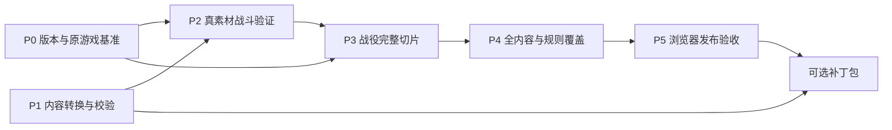

# 实施里程碑与验收

日期：2026-11-16。此文定义完整重制的阶段验收，研究阶段产物是完整文件清单、支持格式的全量解码检查、配置与规则研究、技术方案和可复查证据。后续已启动 [Web 战略先行版](../../sango2-web/README.md)，可操作内政、行军和存档；因采用简化战斗且无敌方 AI，不代表下表 P0–P3 已验收。

## 1. 工作顺序

实施进度补充：v0.2 已有实时战场、分队命令、战中存档及战果回写，见 [当前实现与未校准项](../../sango2-web/docs/V02.md)。伤害/时序未做原程序对照，完整技能与战略 AI 尚缺，因此下面的忠实重制验收门槛仍未通过。

P0的运行基准和P1的转换工作可以并行；P4不能在P2的时间线、锚点、宿主调用未验证时盲目批量填充技能。离线、可选头像、云服务不会替代战役闭环验收。

| 阶段 | 实际工作与产物 | 出阶段门槛 | 工作量/不确定性 |
|---|---|---|---|
| P0 基准冻结 | 当前包指纹、默认开关；原程序关键流程录像、截图、控制变量存档；规则证据表 | 可重复触发内政、出征、战斗、俘虏、存读档；核心未知项有实验与负责人 | 中，原程序运行条件及逆向难度待确认 |
| P1 内容生产线 | 规范化Schema、引用校验、真实图集、资产版本、内容导入器 | 五剧本、620唯一物件、全部资源不丢字段；已知异常显式登记；地图和组合角色正确显示 | 中，图片格式已验证，锚点/索引仍需校准 |
| P2 战斗验证 | 一个战场、两种兵、两名主将、近远程攻击、代表技能、真实动画事件 | 从开战到胜败/撤退完整运行；伤害/时序有依据；实际压力场景预算可达或有修正 | 高，不能用静止精灵性能代替 |
| P3 战役切片 | 一剧本一势力、相邻城池、内政、行军、AI一次合法决策、战斗、结算、存读档 | 同一局完整跑通；重载前后权威状态一致；不会重复结算或丢失归属 | 高，跨系统状态与原规则依赖多 |
| P4 内容完整 | 五剧本、400武将+盗贼、13兵种、常规/特殊阵形、110武将技、67军师技记录、77物品、12地形；全战役AI | 覆盖清单逐项完成，所有核心未知归零或作为明确未完成项阻止“忠实V1”验收 | 很高，脚本宿主和AI为主要成本 |
| P5 可发布 | 浏览器兼容、长局稳定、存档迁移、无音频运行、加载/离线更新、错误恢复 | 发布矩阵全部通过；安装/更新不会破坏现有存档；实际包体与内存有记录 | 中高，真实设备和内容压力测试必需 |

此时不提供未经实验校准的固定交付日期。P0—P2完成后，以“代表技能平均成本、未恢复宿主调用数、战役关键公式数、性能剖析结果”重新估算；全内容工程不能用110个技能乘同一估时。脚本解码研究先给1—2工程周的有界预算，超出后按已经选定的语义重写主线推进，并保留待验证项。

## 2. 功能验收矩阵

“静态已解析”和“运行已复现”是两个状态。初始内容覆盖表位于 [content-coverage.csv](../data/content-coverage.csv)，每条记录目前都标为未实施/未做行为对照，避免把数据导入完成误当功能完成。

| ID | 功能 | 样例/边界 | 合格条件 |
|---|---|---|---|
| C01 | 剧本与选势力 | 5剧本、不同SELECT/Type、盗贼 | 可选列表与基准一致；特殊势力不误暴露为普通选择 |
| C02 | 人物初始化 | 登/野/未、五剧本不同装备/能力 | 同ID人物按剧本正确覆盖，未出场人物不提前出现 |
| C03 | 城市与道路 | 60城、116路、特殊LENGTH=30000、首尾折点 | 可走边与行军时间有依据，不以图连通证明可通行 |
| C04 | 内政 | 搜索、开发、征兵、自治、任命 | 周期、行动限制、资源变化、事件触发可回归 |
| C05 | 成长与成年 | 跨年、多人同时成年、技能等级阈值 | 每人事件只触发一次；HP/MP/技能/兵力上限按规则变化 |
| C06 | 装备与道具 | 唯一物品、禁用等级、已装备/消耗、重开新局 | 不重复生成唯一物品，属性可逆，旧局状态不泄漏到新局 |
| C07 | 出征/入城 | 单队、多将、空城、满员、两队同时到达 | 指令合法、资源归属守恒、超员有明确处理 |
| C08 | 兵种与布阵 | 13兵种、9常规阵形、太公/逼近/偷袭/包围 | 外观变体与能力分离，初始位置和阵形选择符合基准 |
| C09 | 普攻与索敌 | 近战/远程、多个同距目标、目标死亡 | 攻击冷却、命中时点、目标次序、弹道/碰撞均可解释 |
| C10 | 战斗指令 | 前军/后军/主将/全军、待命/突击/撤退 | 指令只影响目标集合，禁止命令与军师技限制生效 |
| C11 | 110武将技 | 每技正常、无合法目标、MP不足、满兵、被封技、施放中结束战斗 | 消耗、目标、作用次数、伤害/治疗、终止均单独检查 |
| C12 | 67军师技记录 | 初中高、智力相同、双方同计、化解、特殊坐骑 | 成功/失败、冲突优先级、持续效果、撤退免疫均有规则样例 |
| C13 | 主将与特效组合 | 身体/武器/坐骑、镜像、遮挡、死亡、旋灯 | 锚点一致、分层正确、事件不随显示帧率丢失 |
| C14 | 战后结算 | 战胜、失败、撤退、连战、无兵有将 | 每场只结算一次，经验/伤亡/HP/MP延续正确 |
| C15 | 俘虏与归属 | 招降/斩首/释放、君主、忠诚/节操边界 | 人物不同时出现在多个势力/军团，规则依据可追踪 |
| C16 | 势力灭亡/盗贼 | 最后一城、在途军团、君主被俘、无主军团 | 无孤立拥有者；统一/失败条件与基准一致 |
| C17 | AI | 无钱、无兵、无路、已败军团、敌军占城、多个可选技能 | 不作弊修改状态，不卡死，决策日志可回放；相似度单独评估 |
| C18 | 中文与对白 | 繁简、占位符、长名、控制码、分段等待 | 字符不乱码，控制码不显示成正文，不吞对话/阻断流程 |
| C19 | 12地形与地图 | 城市三变体、船上、特殊地形、季节 | 原资源绑定正确，掩码语义未经确认不硬编码 |
| C20 | Web存档 | 内政/行军/战前/战斗允许保存阶段、重开网页 | 存档策略明确，保存成功后加载状态一致，随机数/事件不中断 |
| C21 | 存档异常 | 配额不足、损坏文件、旧版本、缺内容包、并发标签页 | 明确拒绝或迁移，上一有效存档可恢复，不静默覆盖 |
| C22 | 音频 | 首次静音、播放拒绝、音量、连续切换场景 | 声音不阻塞玩法，不无限叠加，音乐不全量PCM常驻 |
| C23 | 浏览器与输入 | 缩放/DPR、窗口变化、右键、焦点丢失、WebGL丢失 | 输入坐标正确，后台暂停，图形恢复不破坏模拟 |
| C24 | 更新/离线 | 首次联网、部分缓存、完整缓存、游戏中出现新版本 | 只在资源齐备时提示离线可玩，战役规则版本不热替换 |
| C25 | 可选补丁 | 两种Sango.ini覆盖、13耗蓝改动、头像414编号 | 默认规则不被污染，冲突显式报告，存档绑定选择 |

## 3. 规则验证方法

### 单次实验记录

每个未知规则单独建立记录：实验ID、EXE/PAK哈希、是否可选补丁、剧本与存档、参与人物/兵种/阵形/地形、输入动作、观察值、帧/时间位置、重复次数、推导公式、仍有歧义的参数。原版中的随机试验不能仅凭一次成功/失败推断概率。

技能样本覆盖不同机制：治疗、单体打将、范围清兵、友伤、召唤、持续物件、障碍、武器附着。至少记录MP扣除、首次作用、每次命中、持续/终止、中断后的对象释放。比对精确离散数值；画面/轨迹误差范围在得到基准后设定，不现在编造“100%还原”。

### 三层验证

1. **格式层**：原文件→解析→序列化、引用闭合、图像像素、方向/alpha/锚点。已完成SHP字节往返可作为基线，但不能替代其他格式的语义验证。
2. **规则层**：core无浏览器执行，固定种子与指令序列得到稳定状态哈希；伤害、效果、资源变化、人物归属、事件幂等全部跨模块接口测试。
3. **产品层**：浏览器从新局到战斗、结算、保存、刷新、继续；截图对照、真实输入、声音被拒、图形丢失/恢复、版本更新。

内部确定性与原版一致性分开：相同输入总得相同结果只能证明Web内核可重复，不能证明推导的原版公式正确。统计型随机行为需要分布对照，不能强求未知原随机数状态逐帧一致。

## 4. 性能与稳定性验收

以下是拟定门槛，不是本次已测成绩。P2选择一台参考桌面机并记录CPU/GPU/RAM/系统/浏览器版本、窗口尺寸、DPR、内容版本，之后才冻结指标。

| 项目 | 初始目标 | 检测 |
|---|---|---|
| 显示 | 常规战斗目标60FPS；报告p50/p95帧耗时、最慢帧 | 真素材、真实动画/碰撞/技能，持续采样 |
| 模拟 | 候选30Hz时单tick p95≤8ms的探索预算 | 开启索敌、弹道、持续技能、AI，分别剖析 |
| 峰值规模 | 候选双方200兵+武将+技能峰值，按实测兵力上限调整 | 不以400个静止贴图替代 |
| 图形内存 | 有分场景预算，无全资源常驻 | 统计解码像素/图集填充/上传纹理；不要把PNG大小当显存 |
| 泄漏 | 连续进出战斗、切剧本、读档后无持续增长 | 30次场景循环加至少2小时长局，记录基线与回落 |
| 加载 | 冷/热/离线分开报告；主菜单与可操作场景分开计时 | 真实转换产物上量，记录网络节流参数 |
| 确定性 | 同内容/规则/种子/指令，支持浏览器状态哈希一致 | 10,000 tick回放及跨存读档回放 |
| 稳定性 | 长局无无主人物/重复拥有物品/负资源/死循环 | 内核不变量检查与存档抽样 |

如果不达标，先定位热路径：空间查询、碰撞、每帧创建对象、粒子数量、纹理切换、React重绘和音频解码。优化之后复测同一场景。Worker和WASM都不是跳过剖析的默认答案。

## 5. 优先风险与决策

| 风险 | 当前依据 | 解决路径 | 对计划的影响 |
|---|---|---|---|
| 脚本有原进程内存耦合 | SO新增旧读写辅助函数，原生宿主未知 | 恢复调用意义，转换为受控状态操作，保留未支持清单 | P0/P2最高优先，可能决定技能成本 |
| 相同名称在版本间规则不同 | 回技、劝降、逼近等修复说明 | 固定此包基准，按规则逐项实测 | 不能以Steam参数直接宣布完成 |
| 动画事件与规则耦合 | @攻击、!脚本、#计时 | 内核时间线承载事件，渲染只消费 | 锚点/计时错误会系统性污染所有技能 |
| 遗留计数/模板 | Total*不等于实数，测试物件99缺8图 | 按记录解析、异常清单、运行可达性证明 | 禁止为凑计数补空对象 |
| AI与公式不完全可见 | 配置只给入口/初值 | 基准实验+必要反汇编；近似实现单独标记 | 高不确定性，不给未验证的忠实度承诺 |
| 全图解码内存过大 | 基础SHP原矩形RGBA约375.54MiB | 分包、裁边校正、共享载荷、场景卸载 | 会影响加载策略和兼容设备 |
| 原存档无样本 | SAVES为空 | Web存档优先；原SAV另做格式与版本研究 | 不把原SAV兼容放入首个可玩闭环 |
| 可选文件覆盖冲突 | 两包均替换Sango.ini | 基于ID的字段覆盖和组合检查 | 默认版先交付，可选包后置 |

## 6. 开始实现时的任务清单

1. 新建独立 `sango2-web` 工程，锁依赖与Node版本，保留本报告及原包指纹作为基线。
2. 将当前研究解析器升级成严格内容构建工具：输入输出参数、字段Schema、确定性输出、清晰异常、最小测试样本、许可来源说明。
3. 收集原程序运行基准，优先确认可选君主、内政阶段、移动/战斗时钟、攻击/集气、关键技能和存档边界。
4. 恢复图像锚点/镜像/组合与少量动画token，制作真实地图与战斗预览，不先重画全套UI。
5. 完成独立core、命令与状态快照；建立固定种子回放和存读档一致性检查。
6. 做P2代表战斗后接P3战略闭环；每发现原规则证据，先补规则记录与验收样例，再扩内容。
7. 全内容逐项填覆盖表，最终执行五剧本、全技能、终局和跨浏览器验收。

本轮研究结束时，应保持“解析通过”与“实施通过”两个计数。后续只有实际达到上述门槛，才推进完成状态。
